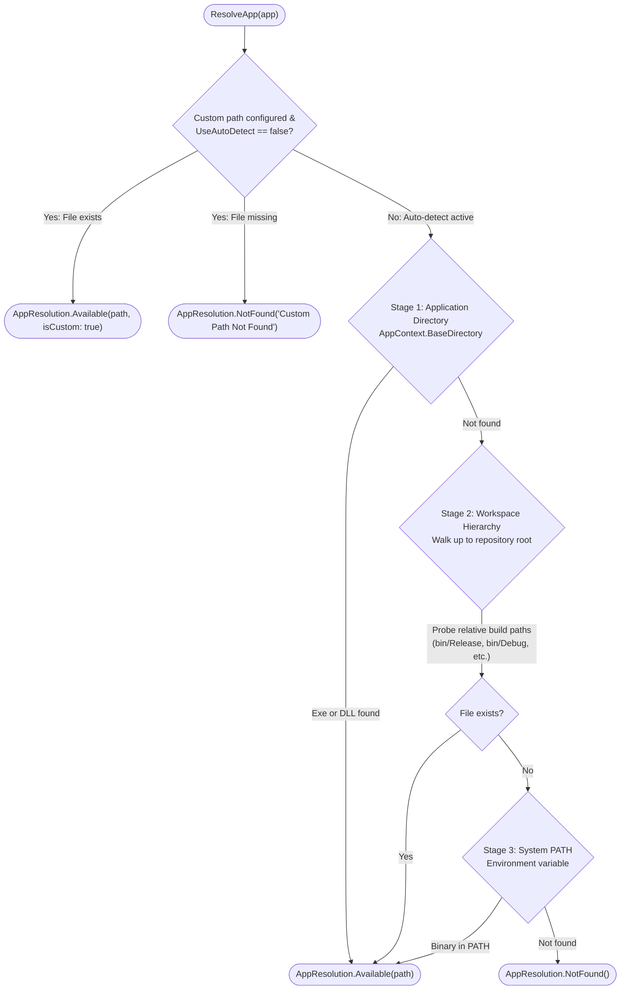

# Application Discovery & Execution in Broiler Launcher

This document explains how **Broiler Launcher** locates, validates, and launches the target applications (**Broiler Browser**, **Broiler Writer**, **Broiler Cell**, and **Broiler Plate**) on Windows and Linux.

---

## 1. Discovery Architecture Overview

The discovery subsystem is implemented in [`AppLauncherService.cs`](file:///d:/Broiler/Broiler.Launcher/src/Broiler.Launcher.Core/Services/AppLauncherService.cs), configured via [`BroilerAppInfo.cs`](file:///d:/Broiler/Broiler.Launcher/src/Broiler.Launcher.Core/Models/BroilerAppInfo.cs), and stored in [`LauncherSettings.cs`](file:///d:/Broiler/Broiler.Launcher/src/Broiler.Launcher.Core/Models/LauncherSettings.cs).

When the launcher initializes or when the user triggers a refresh (<kbd>F5</kbd> or Tools → Refresh Status), the launcher evaluates a **custom-aware resolution pipeline** for each configured application:



---

## 2. The 3-Stage Discovery Pipeline

### Stage 1: Application Directory (`AppContext.BaseDirectory`)
- **Use Case**: Production installs, published self-contained packages, or portable bundles where the launcher and application binaries reside in the same folder.
- **Probe Logic**:
  1. Checks for the platform-native executable:
     - Windows: `<SearchBase>\<WindowsExeName>` (e.g. `C:\Program Files\Broiler\Broiler.Browser.Windows.exe`)
     - Linux: `<SearchBase>/<LinuxBinaryName>` (e.g. `/opt/broiler/Broiler.Browser.Linux`)
  2. If the native executable is not found, checks for the managed assembly:
     - `<SearchBase>\<WindowsDllName>` or `<SearchBase>/<LinuxDllName>`
     - When a DLL is found without an apphost executable, the launcher flags `LaunchWithDotnet = true`.

---

### Stage 2: Workspace Hierarchy & Relative Probes
- **Use Case**: Developer workflows, local builds, monorepo checkouts, and multi-repository clones.
- **Probe Logic**:
  1. The launcher collects candidate root directories by walking up the filesystem tree (up to 5 directory levels) starting from:
     - The launcher's binary directory (`AppContext.BaseDirectory`)
     - The current working directory (`Environment.CurrentDirectory`)
  2. For every candidate root, the launcher tests all paths registered in `app.RelativeProbePaths`.
  3. Checks both `Release` and `Debug` configurations, runtime-specific publishing folders (`net10.0-windows/win-x64`), and Native AOT native output directories (`.../win-x64/native/`).

---

### Stage 3: System `PATH` Search
- **Use Case**: Applications installed globally into system binaries directories or added to the user's environment `PATH`.
- **Probe Logic**:
  - Splits the OS environment variable `PATH` (using `;` on Windows, `:` on Linux).
  - Tests each entry for `<Directory>\<WindowsExeName>` or `<Directory>/<LinuxBinaryName>`.

---

## 3. Application Search Paths Matrix

Below is the complete matrix of binary names and relative build paths scanned for each application:

### Broiler Browser
- **Identifer**: `BroilerAppId.Browser` (`browser`)
- **Windows Executable**: `Broiler.Browser.Windows.exe` (Assembly: `Broiler.Browser.Windows.dll`)
- **Linux Executable**: `Broiler.Browser.Linux` (Assembly: `Broiler.Browser.Linux.dll`)
- **Relative Probe Paths**:
  - `Broiler.Browser/src/Broiler.Browser.Windows/bin/Release/net10.0-windows/Broiler.Browser.Windows.exe`
  - `Broiler.Browser/src/Broiler.Browser.Windows/bin/Debug/net10.0-windows/Broiler.Browser.Windows.exe`
  - `Broiler.Browser/src/Broiler.Browser.Windows/bin/Release-Windows/net10.0-windows/win-x64/Broiler.Browser.Windows.exe`
  - `Broiler.Browser/src/Broiler.Browser.Linux/bin/Release/net10.0/Broiler.Browser.Linux`
  - `Broiler.Browser/src/Broiler.Browser.Linux/bin/Debug/net10.0/Broiler.Browser.Linux`

---

### Broiler Writer
- **Identifier**: `BroilerAppId.Writer` (`writer`)
- **Windows Executable**: `Broiler.Writer.Windows.exe` (Assembly: `Broiler.Writer.Windows.dll`)
- **Linux Executable**: `Broiler.Writer.Linux` (Assembly: `Broiler.Writer.Linux.dll`)
- **Relative Probe Paths**:
  - `Broiler.Writer/src/Broiler.Writer.Windows/bin/Release/net10.0-windows/Broiler.Writer.Windows.exe`
  - `Broiler.Writer/src/Broiler.Writer.Windows/bin/Debug/net10.0-windows/Broiler.Writer.Windows.exe`
  - `Broiler.Writer/src/Broiler.Writer.Windows/bin/Release-Windows/net10.0-windows/win-x64/Broiler.Writer.Windows.exe`
  - `Broiler.Writer/src/Broiler.Writer.Linux/bin/Release/net10.0/Broiler.Writer.Linux`
  - `Broiler.Writer/src/Broiler.Writer.Linux/bin/Debug/net10.0/Broiler.Writer.Linux`

---

### Broiler Cell
- **Identifier**: `BroilerAppId.Cell` (`cell`)
- **Windows Executable**: `Broiler.Cells.Windows.exe` (Assembly: `Broiler.Cells.Windows.dll`)
- **Linux Executable**: `Broiler.Cells.Windows.dll` (launched cross-platform via `dotnet`)
- **Relative Probe Paths**:
  - `Broiler.Cells/src/Broiler.Cells.Windows/bin/Debug/net10.0-windows/Broiler.Cells.Windows.exe`
  - `Broiler.Cells/src/Broiler.Cells.Windows/bin/Release/net10.0-windows/Broiler.Cells.Windows.exe`
  - `Broiler.Cells/src/Broiler.Cells.Windows/bin/Debug/net10.0-windows/Broiler.Cells.Windows.dll`
  - `Broiler.Cells/src/Broiler.Cells.Windows/bin/Release/net10.0-windows/Broiler.Cells.Windows.dll`

---

### Broiler Plate
- **Identifier**: `BroilerAppId.Plate` (`plate`)
- **Windows Executable**: `Broiler.Plate.Windows.exe` (Assembly: `Broiler.Plate.Windows.dll`)
- **Linux Executable**: `Broiler.Plate.Windows.dll` (launched cross-platform via `dotnet`)
- **Relative Probe Paths**:
  - `Broiler.Plate/src/Broiler.Plate.Windows/bin/Release/net10.0-windows/Broiler.Plate.Windows.exe`
  - `Broiler.Plate/src/Broiler.Plate.Windows/bin/Debug/net10.0-windows/Broiler.Plate.Windows.exe`
  - `Broiler.Plate/src/Broiler.Plate.Windows/bin/Release-Windows/net10.0-windows/win-x64/native/Broiler.Plate.Windows.exe`
  - `Broiler.Plate/src/Broiler.Plate.Windows/bin/Release/net10.0-windows/Broiler.Plate.Windows.dll`
  - `Broiler.Plate/src/Broiler.Plate.Windows/bin/Debug/net10.0-windows/Broiler.Plate.Windows.dll`

---

## 4. Process Launching Execution Strategy

Once an application's binary path is resolved, [`AppLauncherService.LaunchApp`](file:///d:/Broiler/Broiler.Launcher/src/Broiler.Launcher.Core/Services/AppLauncherService.cs) starts the process according to its resolved binary type:

### Native Executable Launch
```csharp
var startInfo = new ProcessStartInfo
{
    FileName = resolution.ResolvedPath,
    Arguments = arguments ?? string.Empty,
    UseShellExecute = OperatingSystem.IsWindows(),
    WorkingDirectory = Path.GetDirectoryName(resolution.ResolvedPath) ?? string.Empty,
};
Process.Start(startInfo);
```
- **Windows**: `UseShellExecute = true` integrates with Win32 shell execution and DPI scaling contexts.
- **Linux**: Direct execution invokes the binary in its directory with standard fork/exec semantics.

### Managed Assembly Launch (`dotnet <app.dll>`)
Used when only the `.dll` assembly is present or when running managed components on Linux:
```csharp
var startInfo = new ProcessStartInfo
{
    FileName = "dotnet",
    Arguments = string.IsNullOrWhiteSpace(arguments)
        ? $"\"{resolution.ResolvedPath}\""
        : $"\"{resolution.ResolvedPath}\" {arguments}",
    UseShellExecute = false,
    WorkingDirectory = Path.GetDirectoryName(resolution.ResolvedPath) ?? string.Empty,
};
Process.Start(startInfo);
```

---

## 5. Customization & Settings Page

The launcher provides full customization for each application binary path and command-line arguments.

### Accessing the Settings Page
You can access the settings view through multiple entry points:
- **Header Button**: Click the `"⚙ Settings"` button in the top right of the dashboard header.
- **Menu Bar**: Select `Tools` → `Settings...`.
- **Keyboard Shortcut**: Press <kbd>Ctrl</kbd>+<kbd>,</kbd>.

### Features of the Settings Page
1. **Custom Path Input**:
   - Each application features an editable text box ([`StandardEdit`](file:///d:/Broiler/Broiler.Launcher/src/Broiler.Launcher.Core/UI/SettingsView.cs)) displaying either the auto-detected path or custom path.
2. **File Browser Picker**:
   - Clicking `"Browse..."` opens a native Broiler file dialog ([`StandardFileDialog`](file:///d:/Broiler/Broiler.Launcher/src/Broiler.Launcher.Core/UI/SettingsView.cs)) with executable filters (`*.exe`, `*.dll`, or binary files).
   - Selecting a file immediately fills the path box and marks the path as custom.
3. **Per-Application Auto-Detect**:
   - Clicking `"Auto-Detect"` next to any application runs the 3-stage discovery probe for that single app and populates its detected location.
4. **Global Auto-Detect All**:
   - Clicking `"Auto-Detect All"` in the action bar scans and auto-detects all 4 applications simultaneously.
5. **Custom Launch Arguments**:
   - Each application has an `"Args:"` field for specifying default flags (e.g. `--profile dev`, `--url https://example.com`, `--page-width 1000`).
   - When launching, custom arguments are automatically merged with any additional arguments provided.
6. **Persistence**:
   - Clicking `"Save Settings"` writes the configuration to disk and returns to the dashboard with updated app statuses.

---

## 6. Configuration Persistence (`launcher.settings.json`)

Settings are managed via [`LauncherSettingsStore.cs`](file:///d:/Broiler/Broiler.Launcher/src/Broiler.Launcher.Core/Services/LauncherSettingsStore.cs) and persisted in standard JSON format:

### Storage Locations
1. **Portable Mode**:
   - If a `launcher.settings.json` file is present in the application's root directory (`AppContext.BaseDirectory`), that file is read and updated directly.
2. **Standard User Profile**:
   - **Windows**: `%APPDATA%\Broiler\launcher.settings.json` (e.g. `C:\Users\<user>\AppData\Roaming\Broiler\launcher.settings.json`)
   - **Linux**: `~/.config/broiler/launcher.settings.json` or `$XDG_CONFIG_HOME/Broiler/launcher.settings.json`

### JSON Schema Example
```json
{
  "Apps": {
    "Browser": {
      "ExecutablePath": "D:\\Broiler\\Broiler.Browser\\src\\Broiler.Browser.Windows\\bin\\Release\\net10.0-windows\\Broiler.Browser.Windows.exe",
      "Arguments": "--enable-gpu",
      "UseAutoDetect": true
    },
    "Writer": {
      "ExecutablePath": "C:\\CustomTools\\Writer\\Broiler.Writer.exe",
      "Arguments": "--recent-docs",
      "UseAutoDetect": false
    }
  }
}
```

---

## 7. Inspecting Discovery via Command Line

You can inspect the exact resolved location of each application or view the active configuration at any time using CLI options:

### List Resolved Applications
```powershell
dotnet run --project Broiler.Launcher/src/Broiler.Launcher.Windows -- --list
```

**Example output:**
```
Broiler Suite Applications:

  Broiler Browser    [Ready - Auto]     D:\Broiler\Broiler.Browser\src\Broiler.Browser.Windows\bin\Release\net10.0-windows\Broiler.Browser.Windows.exe
  Broiler Writer     [Ready - Custom]   C:\CustomTools\Writer\Broiler.Writer.exe
                     Custom Args:       --recent-docs
  Broiler Cell       [Ready - Auto]     D:\Broiler\Broiler.Cells\src\Broiler.Cells.Windows\bin\Debug\net10.0-windows\Broiler.Cells.Windows.exe
  Broiler Plate      [Ready - Auto]     D:\Broiler\Broiler.Plate\src\Broiler.Plate.Windows\bin\Release\net10.0-windows\Broiler.Plate.Windows.exe
```

### View Configuration File & Overrides
```powershell
dotnet run --project Broiler.Launcher/src/Broiler.Launcher.Windows -- --config
```

**Example output:**
```
Broiler Launcher Configuration:

  Config file: C:\Users\user\AppData\Roaming\Broiler\launcher.settings.json
  File exists: True

Customizations:
  Broiler Writer:
    Executable:  C:\CustomTools\Writer\Broiler.Writer.exe
    Arguments:   --recent-docs
    Auto-Detect: False
```

If an application reports `[Not Found]`, build that project once with:
```powershell
dotnet build Broiler.<AppName>/src/...
```
The launcher will instantly detect the newly built executable upon refresh.
