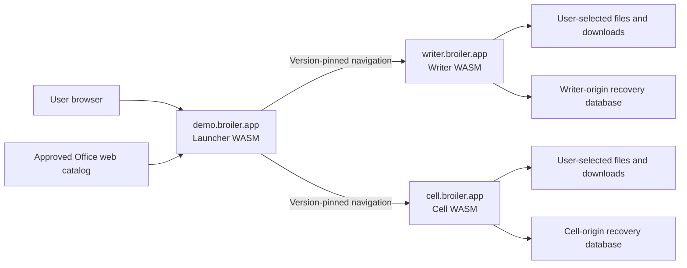

# Broiler Office in the web browser — investigation and delivery roadmap

Date: 2026-10-28. Status: proposed roadmap, based on source inspection, two local
WebAssembly publish probes and bounded public-domain probes. This task does not
implement or deploy the web edition. Existing desktop delivery remains intact.

## 1. Outcome and scope

Deliver three independently published, client-side .NET WebAssembly applications:

| Address | Application | Initial behavior |
| --- | --- | --- |
| `https://demo.broiler.app/` | Broiler Office Launcher | Show the suite, open Writer/Cell, show versions and browser settings |
| `https://writer.broiler.app/` | Broiler Writer | Edit documents locally; browser-native open and export |
| `https://cell.broiler.app/` | Broiler Cell, implemented by `Broiler.Cells` | Edit sheets locally; complete browser integration for the current CSV feature set |
| Browser card | Broiler Browser | Visible, grayed out, disabled; explanation: outside this web edition |
| Plate card | Broiler Plate | Visible, grayed out, disabled; explanation: outside this web edition |

Keep existing product IDs and serialized enum values. The external address and
catalog ID use singular `cell`; the repository and existing project/namespace use
`Broiler.Cells`. `browser-wasm` is the runtime target, not the enabled status of
the Broiler Browser product.

The recommended first edition processes documents in the user's browser and
requires no account, local executable, local .NET installation or BOSS process.
A static HTTPS host is sufficient. Browser downloads remain the universal export
path. Cloud storage, collaboration, authentication, browser-to-desktop control,
and Excel/Word feature parity are separate expansions, not hidden prerequisites.

Two acceptance levels prevent a drawing demo being mistaken for a complete app:

- **Online demonstration:** all three URLs work; Launcher navigation is reliable;
  Writer and Cell can create, edit, open and export the explicitly supported
  formats; unsupported products/actions are clearly disabled.
- **Public editable v1:** add tested recovery from reload/crash, actionable storage
  errors, browser/keyboard/accessibility validation, safe deployment/update
  behavior, and documented performance/file-size limits. Do not invite users to
  trust important documents before these gates pass.

PWA installation/offline operation is a useful later release. Installing a PWA is
different from the desktop launcher's user/machine installation commands.

## 2. What already exists, and what is missing

The web work is substantially reuse and completion, especially for Writer.
Neither Writer nor Cell needs a new rendering engine or a mandatory Blazor rewrite.
Both existing heads use `Microsoft.NET.Sdk.WebAssembly`, .NET 10, JS interop and
the Broiler direct Canvas 2D renderer. Microsoft's standalone .NET browser interop
model is applicable; Blazor-specific hosting/boot APIs must not be copied into
these projects without adapting them. [S1]

### Findings from the checked-out source

| ID | Evidence | Consequence / required work |
| --- | --- | --- |
| F01 | Launcher has Windows/Linux heads and no WebAssembly project. `LauncherView` creates install paths, installation/update services and a BOSS controller by default. | A new browser head and explicit host/capability boundaries are needed; adding a WASM target alone is insufficient. |
| F02 | `BroilerAppInfo.GetPlatform(bool)` distinguishes Windows/Linux; the current UI labels a non-Windows host Linux. | Add browser capabilities explicitly. Do not interpret `OperatingSystem.IsWindows() == false` as Linux in the browser. |
| F03 | Writer already has a trimmed .NET 10 browser head, a Canvas presenter, text/IME/clipboard bridges and browser file import/export. | Reuse and validate it; focus on deployment, recovery and web acceptance. |
| F04 | Writer browser code reads/writes RTF, DOCX, ODT, HTML and Markdown. It serializes to bytes, initiates a download and immediately clears its modified state. | Existing codecs are available, but file fidelity and export-completion semantics need tests. Download initiation does not prove a durable save. |
| F05 | Writer has unsaved-change tracking and a `beforeunload` handler; no durable browser recovery store was found in its browser head. | Preserve warnings, add durable checkpoints, and test interrupted export/navigation. |
| F06 | Cells already has a WebAssembly head and its CI builds/publishes that head. | This is not a port from zero. Complete and test the existing head. |
| F07 | Cells' JS `requestOpenFile` is empty. Shared `CellsView` still opens virtual/native-style file dialogs and uses path-based `File`/CSV operations. | Introduce a document service and wire browser Open/Save commands to it; do not expose virtual filesystem paths as the user's real disk. |
| F08 | Cells' JS wires pointer/keyboard events, but its hidden textarea has no corresponding committed-text/IME/clipboard listeners. Managed text/clipboard exports exist; `publishFrame` is a no-op. | Complete caret/focus, text, composition, trusted clipboard and pointer-cancel integration. A visible grid alone is not usable editing evidence. |
| F09 | `SheetModel` stores strings in a bounded matrix, currently capped at 100 rows × 100 columns. `SheetCsvSerializer` is the file path; no calculation engine or XLSX/ODS workbook implementation was found in the inspected Cells application sources. | Label initial capability honestly. Large workbooks, formulas and Excel interoperability are a separate engine/format workstream. |
| F10 | Cells suppresses `CA1416` warnings in its browser project. | Audit reachable platform APIs rather than treating suppressed platform warnings as portability proof. |
| F11 | Writer's publish workflow now has a reusable web artifact; Cells' publish workflow still states its web head is not released to GitHub Releases. No launcher web producer exists. | Finish the three browser artifact producers and add a web-specific Office lock/catalog. |
| F12 | Writer and Cells vendor matching copies of `broiler.graphics.webassembly.js` in this checkout. Shared Hosting currently has native-platform hosts, with browser adapters living in application/sample code. | Verify the replay ABI against the exact managed package. Consolidate browser host contracts without loading a mutable shared runtime across apps. |
| F13 | Browser heads expose a canvas and a hidden textarea, but no app-specific DOM accessibility bridge was found. Broiler.UI already has semantic node/provider contracts. | A canvas `aria-label` does not expose the document or sheet structure; add a tested semantic bridge. [S8] |

### Local publish probes — confirmed deployment issue

Both commands completed successfully in this environment:

```powershell
dotnet publish Broiler.Writer/src/Broiler.Writer.WebAssembly/Broiler.Writer.WebAssembly.csproj -c Release -p:RunAOTCompilation=false -o artifacts/web-roadmap-investigation/writer
dotnet publish Broiler.Cells/src/Broiler.Cells.WebAssembly/Broiler.Cells.WebAssembly.csproj -c Release -p:RunAOTCompilation=false -o artifacts/web-roadmap-investigation/cell
```

The published outputs show:

| Probe | Writer | Cell |
| --- | --- | --- |
| Publish succeeds | Yes | Yes |
| Generated entry module | Fingerprinted `m.<hash>.js` | Fingerprinted `m.<hash>.js` |
| Published HTML references an existing entry module | Yes | **No: references `main.js`, which is absent** |
| Published HTML has an import map | Yes | No |
| Stable Canvas replay module present | Yes | Yes |
| Directory size, including `.br`/`.gz` alternatives | 18,040,077 bytes | 15,051,573 bytes |

**Cell's published entry point is P0.** Fix the HTML/SDK fingerprint/import-map
contract before claiming a deployable head. Check actual output, not a guessed
hashed filename. Missing JS/runtime resources must produce a real failure, not an
HTML fallback. The directory sizes above are not browser transfer-size or memory
measurements; they include precompressed alternative files.

These probes did not execute either app in a browser or prove document editing.
Source inspection plus artifact checks are the evidence, not runtime acceptance.

### Domain probes

At investigation time, from this environment:

- `demo.broiler.app` resolved and answered HTTPS with HTTP 200 from Apache. Its
  returned HTML appeared to be a hosting-provider landing page, so this does not
  establish that the Office launcher is deployed.
- `writer.broiler.app` and `cell.broiler.app` did not resolve through the local
  resolver. Confirm authoritative DNS and hosting control before deployment.
- No DNS, hosting settings, files or certificates were changed.

Investigation outputs are in `artifacts/web-roadmap-investigation/findings.json`,
`artifacts/web-roadmap-writer-publish.log`, and
`artifacts/web-roadmap-cell-publish.log`. They are local evidence, not release
artifacts. Reviewed revisions: integration `d242ae269fd6ba523b8594bb2ecba2fc9ccdb787`,
Writer `b83b8a730965b4ac2b4eff1a0d2227d1762ae574`,
Cells `6cdb620d623f7c1b9d33b87d75c9700ed4cc0d2f`.

## 3. Recommended runtime architecture



### Separate top-level applications

Default to same-tab navigation with an explicit user-controlled new-tab option.
Only the selected application's runtime is loaded. Do not preload three .NET
runtimes into hidden iframes, or make a parent iframe shell mandatory.

Separate subdomains are separate origins: browser storage and document access do
not automatically carry across them. A launcher service worker cannot manage all
three origins as one local application. Keep recovery/settings app-local; no
shared document library is promised for v1. Ordinary navigation needs no CORS
permission. Fetching app metadata from another origin does. Prefer a single
same-origin launcher catalog over three cross-origin health probes that might
misreport CORS failures as unavailable products. [S2]

Use exact allowlisted HTTPS origins. Do not accept an arbitrary `launchUrl`
query parameter or a remote catalog that can navigate to another site. Allow a
fixed Return to Office link in each app. A direct visit to Writer/Cell must work
without a launcher session, opener or cookie.

New-tab opening must be associated with a trusted user action. Canvas input
queued to a later animation frame can lose that association. Prefer genuine DOM
links/accessible link overlays for navigation, or a measured synchronous bridge;
always retain same-tab fallback. Browser navigation owns the lifecycle, not a
native process handle.

### Capability-based launcher

Introduce a browser host and services; names below are proposed contracts:

- `LauncherHostKind` / `ProductCapabilities`: desktop versus browser, navigation,
  local document IO, persistence, installation and server-management support.
- `IProductLaunchService`: desktop process creation or browser navigation.
- `ILauncherPreferencesStore`: native atomic JSON or browser storage, with a
  distinct schema for web-only preferences.
- `IWebSuiteCatalogClient`: same-origin approved web catalog, with bounded fetch,
  version validation, cache and an offline/unavailable state.
- Browser host contracts for documents, trusted clipboard, text/IME, settings,
  rendering, accessibility and recovery. Prefer publishing reusable
  `Broiler.Hosting.WebAssembly` facilities when their contract is established.

Inject services into shared presentation code without constructing desktop
defaults in browser startup. If needed, separate native installation/BOSS/CLI
code into a desktop assembly so the browser dependency closure cannot reach it.
Desktop constructors and settings migration must remain regression-tested.

| Desktop action/setting | Web-edition behavior |
| --- | --- |
| Launch Writer/Cell | Open approved browser app URL |
| Browser/Plate launch and shortcuts | Disabled; explanatory text available to assistive technology |
| Install for user/all, repair, machine elevation | Absent |
| Start/stop local BOSS, process logs, executable discovery | Absent |
| Native executable paths and command-line arguments | Absent |
| Installed version and receipt scope | Replace with deployed app/version/channel information |
| Desktop Update | Replace with safe app-release availability/reload behavior |
| Settings | Theme, motion, navigation preference, channel policy, app-local recovery/storage controls |
| Exit | Return to Office where useful; do not assume scripts may close arbitrary tabs |

Disabled Browser/Plate cards must have disabled commands as well as muted styling.
Test mouse, touch, keyboard accelerators, menus and accessible state. Do not
renumber the existing app IDs or imply Plate is technically impossible in WASM;
it is intentionally excluded from this configuration.

### BOSS's role

BOSS can optionally serve static web files on an operator's server. It is not
required for client-side editing, cannot be started as a local daemon by the web
launcher, and does not become a WASM process inside the browser. A future cloud
API is a separate backend project with its own authentication/operations scope.

## 4. Work packages

### W0 — establish reproducible browser baselines (P0)

**Baseline implemented (2026-10-28):** see the [W0 findings and remaining
gates](broiler-office-web-w0.md) and [repeatable browser harness](../tests/office-web/README.md).
Published Writer/Cell artifacts pass twelve cold/warm Chromium, Firefox and
WebKit cases and three missing-entry negative cases. Basic Cell text input is
wired; full application input/document acceptance remains in W3/W4/W7.

1. Pin SDK/workload and dependency versions for browser producers. Record current
   trimming, interpreter/AOT and graphics replay requirements.
2. Fix Cell's published `index.html`, import-map and entry fingerprint handling;
   verify every generated HTML/module/runtime reference exists under its release
   prefix. Preserve the stable replay-module URL only as a version-scoped asset.
3. Serve the exact published Writer/Cell outputs with correct MIME types and
   compression. Boot in real Chromium, Firefox and WebKit automation; use actual
   Safari for a claimed Safari support tier.
4. Record startup failures, network bytes, cold/warm ready time and basic input
   behavior. Audit reachability behind Cells' `CA1416` suppression.

**Exit:** a clean browser reaches a managed ready state and an actual editable
surface from both published artifacts, with no missing resources, MIME errors,
fatal console errors or placeholder import maps. A negative missing-resource
fixture reports failure. Compilation alone is not acceptance.

### W1 — browser host contracts and shared services (P0/P1)

**Foundation implemented (2026-10-28):** see [W1 validation and adoption
steps](broiler-office-web-w1.md). Browser launcher services are isolated from
native composition; document/event contracts and the renderer/replay package
checks have fake-provider, package and three-engine browser coverage. Publish
the shared package changes before production consumers adopt them in W2–W4.

1. Split platform-dependent launcher factories and browser capabilities. Keep
   native providers out of the web boot path and retain desktop tests.
2. Define a shared document port with byte/stream-based open/export, filename and
   operation result; native providers may keep path-based implementations.
3. Standardize frame dispatch, resize/DPR, caret positioning, pointer cancellation,
   committed text, IME and trusted clipboard behavior using the existing Writer
   implementation as a starting point.
4. Bind the managed renderer and replay JS to one tested package/protocol version.
   Add publish-time asset hashes/ABI checks. Avoid application-owned stale copies
   or a floating global replay script.

**Exit:** browser services have fake-provider tests and one real browser contract
sample; a browser launcher cannot instantiate native install/BOSS services;
Writer and Cells can adopt shared facilities without desktop regressions.

### W2 — Launcher WebAssembly head (P1)

**Implementation/local acceptance complete (2026-10-28):** see [W2 results and
release prerequisites](broiler-office-web-w2.md). The packaged browser head and
published editor navigation pass Chromium/Firefox/WebKit, with resilient HTML
fallbacks and browser-only preferences. Live-domain acceptance still requires
published W1 packages and W6 hosting; local verification uses explicit isolated
integration packages and intercepted HTTPS origins.

1. Add `Broiler.Launcher.WebAssembly` with the existing Broiler UI/Canvas stack,
   bootstrap HTML, JS interop, loading/error UI and a recoverable startup failure.
2. Supply the web-specific catalog/capabilities and exact Writer/Cell origins.
   Disable Browser/Plate, native install/update/server actions and their shortcuts.
3. Implement navigation, Return to Office links and separate browser preferences.
   A launcher load failure should leave accessible fallback links to the two apps.
4. Show app/channel/version information from approved deployment metadata, not
   guessed running/installed status. Do not require cross-origin readiness probes.

**Exit:** `demo.broiler.app` opens either app by mouse and keyboard; direct app
visits work; popup denial has a usable fallback; disabled cards execute no action;
startup makes no filesystem/process/administrator request.

### W3 — finish Writer for the hosted edition (P1)

**Verification still open:** browser safety/format work is present, but the latest
full W3 run timed out on Firefox's first RTF download after passing Chromium.
Do not treat five-format, three-engine Writer acceptance as complete yet.

1. Prove current browser operations: New, edit/format, undo/redo, select,
   cut/copy/paste, Open, Save/Export and Save As. Include cancellation/error cases.
2. Test RTF/DOCX/ODT/HTML/Markdown round trips with representative fixtures and
   visible unsupported-feature diagnostics. Define fidelity expectations rather
   than assuming desktop parity from shared codec names.
3. Separate `ExportInitiated`, `SavedToHandle`, `Canceled` and `Failed` results.
   Keep recovery data when fallback downloads cannot confirm disk persistence.
   A Save-then-New/Close flow must not silently discard the only recoverable copy.
4. Audit fonts, embedded images, links, large documents and error handling. Expose
   only browser-tested printing/export formats; PDF printing/export is a separate
   task if it is part of the chosen parity target.

**Exit:** all advertised operations complete through the browser sandbox, file
errors preserve the current document, and the format/fidelity matrix is published.

### W4 — complete Cells' browser integration (P0/P1)

**Implementation/evidence:** [W4 report](broiler-office-web-w4.md) describes the
browser command adapter, strict shared CSV path, input/clipboard and modified-sheet
protection. Formal adoption of W1's `IDocumentPort`/shared JS still requires the
unpublished Hosting packages; W5 owns persistent recovery integration. These remain
explicit follow-ups rather than hidden source-reference production dependencies.

1. Fix the boot blocker from W0 and connect shared Cell menu/toolbar commands to
   the document port; replace the empty `requestOpenFile` implementation.
2. Open selected CSV bytes through the stream serializer. Export a real Blob
   download or an explicitly supported file handle. Save never means writing an
   arbitrary desktop path inside the WASM virtual filesystem.
3. Wire textarea focus/caret, committed input, IME composition, clipboard events,
   pointer capture/cancel, touch, wheel and resize. Remove debug spam and implement
   meaningful frame state instead of no-op `publishFrame`.
4. Add modified-state tracking, change notifications, New/Open/Close confirmation
   and the recovery integration from W5. Retain the original sheet on failed load.
5. Publish the actual current limits: CSV, bounded sheet size and string values.
   Report over-limit input clearly; do not silently truncate or imply formulas
   have calculated results merely because the UI contains a formula bar.

**Exit:** a real browser can type Unicode/IME text into a cell, navigate, commit,
undo where supported, copy/paste, open a CSV and export/reopen it. Unsupported
features and limits are explicit. The browser shares the tested core model with
desktop; it does not introduce a second inconsistent CSV engine.

### W5 — recovery, preferences and reliable local data (P1 before public v1)

**Implementation/evidence:** [W5 report](broiler-office-web-w5.md) describes
origin-local IndexedDB checkpoints for Writer/Cells, separate page/document
identities, pending-edit capture, explicit restoration and backup export/import,
storage-failure handling and transactional migration. Recovery uses supported
application representations, with Writer's RTF fidelity boundary stated explicitly.
Normal-profile recovery is verified in Chromium, Firefox and WebKit; Firefox
non-persistent/private-session download acceptance remains an explicit open item.
Public hosting remains W6; device/Safari and broader fidelity acceptance remain W7.

1. Store app-local document checkpoints and revision/schema metadata in IndexedDB;
   reserve small preference storage for settings. Each tab/document has an
   explicit identity, and concurrent tabs must not overwrite each other's drafts.
2. Checkpoint after changes with bounded debounce, and on useful lifecycle signals.
   A `beforeunload` warning is supplementary; it is not a durable recovery design.
   Test abrupt tab/browser termination and restore the latest committed snapshot.
3. Handle quota denial, eviction, private browsing and failed transactions. Offer
   export, document deletion and clear-local-data controls with an explanation of
   what is retained. Persistence requests are best effort, not a backup guarantee.
4. Make store migrations recoverable; keep the old snapshot until migration
   commits. App updates cannot erase drafts or treat cached assets as documents.

Browser storage is origin-specific and may be unavailable or reclaimed. [S2, S4]
Unload events are not dependable in every lifecycle, especially on mobile. [S7]

**Exit:** reload/crash recovery works in supported browsers, failure is visible,
simultaneous tabs are isolated, and recovery/export survive an application update.

### W6 — artifact producers, web suite integration and hosting (P1)

**Implementation:** producer/release, artifact-only integration, independent
GitHub Pages staging, approved catalog promotion and rollback are implemented;
see [W6 delivery and operations](broiler-office-web-w6.md). Local tests pass.
**Live acceptance remains open** until published W1 packages and real producer
releases, Pages/DNS/HTTPS configuration, first promotion and rollback are exercised.

1. Release independent Launcher/Writer/Cell web-static archives containing the
   complete published `wwwroot`, including generated HTML/import map, framework
   files, managed assets, JS, fonts and media. Choose one initial trimmed
   interpreter/runtime configuration; evaluate AOT separately as a distinct build.
2. Complete Cells' reusable release artifact and the new launcher web producer.
   Reuse Writer's web archive for its standalone site and BOSS where compatible;
   do not rebuild it in Office or rewrite its contents during deployment.
3. Add **separate** `office-web.lock.json` and `office-web-release.json` contracts.
   Desktop tooling is currently Windows/RID/install oriented; browser support must
   not weaken that validator or masquerade as a `win-x64` package.
4. Pin exact component versions, producer repositories/tags/commits, asset IDs,
   archive sizes/digests, web runtime mode, replay/input protocol and entry prefix.
   Record Browser/Plate as intentionally disabled, rather than missing artifacts.
5. Integration downloads these artifacts, validates assets and runs browser tests.
   Deploy complete immutable release directories on all three origins first.
   Publish the approved launcher catalog last, pointing to those exact versions.
6. Configure DNS/TLS/document roots, MIME types, caching, compression and security
   headers. Use staging, a health/readiness check and a reversible promotion.
   Review the default page before replacing `demo.broiler.app` content.

**Exit:** a clean runner deploys tested artifacts with no application rebuild;
version/digest ledgers match deployed files; domain and browser checks pass;
switching the approved catalog back restores the previous usable release.

### W7 — browser quality and accessibility (P1 for public v1)

1. Exercise current Chromium/Edge, Firefox and Safari support tiers, keyboard-only
   use, 100/150/200% DPI, zoom, dark/high-contrast preferences, long translations,
   IME, dead keys, touch and virtual keyboard resizing.
2. Connect Broiler.UI semantics to a DOM accessibility layer: actionable controls,
   names/states, focus, rich-text selection/caret and virtualized grid coordinates.
   The hidden input bridge is useful for text entry but does not describe the
   whole document/table to assistive technology. Test NVDA and VoiceOver. [S8]
3. Benchmark representative documents/sheets. Keep large operations cancelable,
   show progress, bound decoding/import memory, and avoid rendering every item
   offscreen. Profile unnecessary CPU fallbacks and per-frame logging.
4. Define supported browser versions and unsupported-state messaging. Do not
   globally suppress failures or advertise a browser based on one engine's pass.

**Exit:** the browser support matrix has interaction evidence, usable keyboard
and screen-reader flows, and documented performance limits.

### W8 — offline/PWA and deeper suite integration (P2)

Add per-origin manifests/icons/service workers only after normal online releases
and recovery are reliable. Cache one complete versioned app closure, stage updates
without activating them over unsaved work, and retain compatible previous assets.
Test warm offline startup, interrupted cache fill and rollback. Each origin owns
its worker/cache; a launcher PWA does not install the editors on the user's behalf.

Optional later integration includes a recent-document broker or explicit document
handoff. It needs a versioned, bounded protocol, consent, exact origin/source
validation and transfer validation. `postMessage` is a transport, not a shared
database or authorization boundary. Do not use wildcard target origins or put
document bytes in URLs. Cross-origin opener policies must be included in that
design, especially before adding threaded WASM. [S5, S6]

**Exit:** offline/update failure cannot lose recovery data or mix runtime versions;
handoff, if implemented, rejects unexpected origins and oversized/unexpected data.

## 5. File IO and browser behavior contract

| Capability | Universal baseline | Optional enhancement |
| --- | --- | --- |
| Open | User-selected file input, stream/bytes into managed code | Native file picker API where supported |
| Export | Blob download, visible status and retained recovery copy | Writable file handle with successful-write confirmation |
| Save | Export action; honest result semantics | Reuse a still-permitted file handle |
| Clipboard | Trusted copy/cut/paste events and text bridge | Async clipboard API after permission/capability checks |
| Persistence | App-origin IndexedDB checkpoints, with failure handling | Persistent-storage request and richer OPFS storage after validation |
| Navigation | Version-pinned same-tab link | New tab/window from an accepted trusted gesture |
| Printing | Browser-tested print/export path or clearly disabled action | App-generated print layout/PDF after format validation |

Native file pickers are not supported uniformly and require appropriate user
activation; they must be progressive enhancements, not the sole file path. [S3]
Browser file input provides user-selected file data, not unrestricted filesystem
access. [S9] Clipboard permissions and activation behavior differ across browser
implementations, so test the trusted-event fallback separately. [S10]

Prefer binary interop/streams over repeated base64 conversions when practical.
The current bridge makes multiple copies of document bytes; set measured size
limits first. Reject malformed/oversized archives and preserve the active document
on parse failure. Review external-resource fetching, URL schemes and HTML import;
document content must not become executable page markup or outbound telemetry.

## 6. Origin, deployment and update decisions

### Asset closure and routes

Use immutable app prefixes such as `writer.broiler.app/releases/<version>/` and
the equivalent launcher/Cell locations. Root URLs resolve to an approved default
release, while the launcher pins exact release paths. Include path-prefix tests:
the current managed Canvas loader's `../broiler.graphics.webassembly.js` and SDK
generated module URLs must resolve correctly from the actual runtime module base.

Never replace `_framework` or JS files one by one under an active release URL.
A central catalog switch gives a coherent launch snapshot; independent HTTP/DNS
updates across three origins are not literally one atomic transaction. Upload and
verify all target closures before promotion. Retain release directories used by
open tabs; keep at least the current and rollback releases and a retention policy.

Mutable root HTML/catalog/worker entry points should revalidate. Content-hashed
assets may be immutable-cache candidates. Stable-named JS is cacheable as immutable
only inside an immutable version prefix. Missing module/WASM paths must return
404, not a successful HTML page.

### Host capabilities

Verify the chosen host, including Apache if retained, supports:

- HTTPS for each requested hostname, usable certificates and redirects;
- `.wasm` as `application/wasm`, JavaScript/JSON/font MIME types, and sensible
  missing-resource responses;
- correct `.br`/`.gz` negotiation and original MIME types/`Content-Encoding`, plus
  `Vary: Accept-Encoding` where needed;
- cache/security headers and staged immutable release directories;
- required request/file-count limits and a repeatable rollback/deployment method.

A browser edition needs HTTPS/TLS hosting, not Windows executable-signing
certificates. The existing desktop signing gate stays separate. Provider access
and deployment credentials are operational dependencies; none were available or
modified in this investigation.

### CSP, isolation and security

Start with a small self-hosted asset set. Test CSP against the exact .NET/browser
bundle, including its generated inline import map and required WebAssembly
execution allowance. Prefer hashes/nonces for required inline content; do not
enable broad script evaluation just to hide errors. Use report-only checks before
enforcement, then add negative fixtures. [S11]

Keep the first release single-threaded unless measurements demand otherwise.
Threaded/shared-memory WASM may require cross-origin isolation and suitable host
headers, which also affect popup/opener communication and resource loading. Do
not turn those headers on blindly across the subdomains. [S6]

Use no document content, names or clipboard payloads in analytics/error telemetry
by default. Sanitize filenames and hyperlinks; disallow unexpected script/data
navigation. Keep deployment secrets out of downloadable artifacts. SHA-256 checks
establish artifact correspondence; they do not protect against an attacker who
can replace both hosted JS and its same-origin catalog.

### Offline update policy

Service workers are optional for the online edition. When added, preserve the
normal waiting lifecycle or implement an explicit user-approved update action;
avoid forced takeover while an editor has unsaved work. A failed new asset cache
must leave the previous app usable. Worker caches and document databases have
separate migration/retention policies. [S12]

## 7. Web release contract and artifact-first pipeline

Extend the accepted [artifact-first design](broiler-office-artifact-first.md)
with a browser-specific matrix. Keep product releases, Office integration and
deployment promotion independent.

```text
Launcher web producer ─┐
Writer web producer ───┼─> published web-static artifacts + source/hash manifests
Cell web producer ─────┘
                            |
                    reviewed office-web.lock.json PR
                            |
                    download exact artifacts
                            |
                local multi-origin browser integration
                            |
                staging: headers, IO, recovery, navigation
                            |
              immutable deployment to the three origins
                            |
                  publish approved catalog last
```

The web lock should contain the suite/channel, three independent versions, exact
archive/producer identity and digests, browser target/runtime mode, allowed origin,
release prefix, supported IO formats, disabled products, and minimum web-host /
catalog protocol versions. Do not infer file formats or support from a product's
name. A single approved catalog should describe a complete tested set.

Proposed delivery units:

- component browser archives and `component-release.json` entries with
  `rid: browser-wasm`, explicit `artifactKind: web-static` and a supported runtime
  mode; keep NativeAOT desktop publishing mode distinct from browser AOT;
- `office-web.lock.json` and `office-web-release.json`, with per-origin launch
  paths and independent versions;
- exact asset checksums, source/dependency/replay-protocol records and browser
  integration reports;
- optional complete offline/self-host bundle after W8, with the same unchanged
  component closures; it is not a native installer.

Generalize the producer manifest helper deliberately: its current `writer-web`
special case and desktop-oriented entry-point/RID assumptions do not yet describe
all three web products. Browser packages must not be attached as Windows programs
or consumed by the desktop installer accidentally.

An independently released component does not update a public site automatically.
Integration approves a combination; deployment promotes its artifacts without
rebuilding them. App/root and launcher versions can evolve separately, but the
launcher starts an exact approved snapshot. A long-lived editor tab must have a
safe recovery/export path before it is asked to reload a newer release.

## 8. Test and acceptance matrix

| Area | Required evidence |
| --- | --- |
| Build/publish | Pinned SDK/workload; trimmed publish; genuine final artifacts; all HTML/import-map/JS/WASM references exist |
| Ready state | Real browser completes boot and draws meaningful UI; errors/missing assets fail clearly |
| Launcher | Correct URLs, disabled cards/shortcuts, direct visits, same-tab/new-tab behavior, no desktop APIs |
| Text/input | Unicode, IME, dead keys, caret/selection, shortcut conflicts, repeat keys, touch/pointer cancel, zoom/DPR |
| Clipboard | Trusted copy/cut/paste, permission denial, empty/multiline content; no silent data loss |
| Writer | Advertised format round trips, images/fonts, unsupported-feature diagnostics, cancel and malformed/oversized files |
| Cell | CSV quoting, delimiters/locale, Unicode/newlines, dimension limits, edit/commit/navigation, export/reopen |
| Data safety | Dirty-state prompts, export initiated versus saved, quota/private-mode failure, reload/crash restore, two tabs |
| Deployment | Actual HTTPS/MIME/compression/cache/CSP; immutable prefixes; cold/warm cache; old tab plus new deployment; rollback |
| Accessibility | DOM semantics, meaningful disabled states, keyboard focus, NVDA/VoiceOver, virtualized text/grid behavior |
| Browser matrix | Automated Chromium/Firefox/WebKit plus real desktop Safari where claimed; touch/mobile separately accepted |
| PWA if added | Offline revisit, first visit offline messaging, interrupted cache install, waiting worker and update over dirty editor |

Suggested project additions include browser contract/unit tests, Playwright
multi-origin flows, published-asset/reference validation, a web package smoke
script, and a preview deployment gate. Tests should run against published output
and production-like headers, not only a development server. Use synthetic test
documents, never a maintainer's real documents or browser profile.

Define and measure budgets in W0 rather than declaring success from arbitrary
numbers. Planning targets to ratify: launcher interactive within 3 seconds,
editors within 10 seconds on an agreed cold-network profile, and p95 edit feedback
within 100 ms on the reference laptop. Include throttled CPU/network, document
load time, transferred bytes, peak memory and background/idle behavior. Initial
file-size/sheet limits must be explicit; mobile gets its own evidence and limits.

## 9. Delivery order, dependencies and effort

Estimates are engineering person-days, not elapsed promises. They assume the
current Canvas UI/codec model is reused and the first Cell edition remains CSV.

| Milestone | Priority | Depends on | Estimate | Reviewable delivery |
| --- | --- | --- | --- | --- |
| W0 baseline and Cell boot fix | P0 | Current heads | 2–4 | Published-artifact/browser boot reports and corrected resource graph |
| W1 host and service boundaries | P0/P1 | W0 findings | 3–5 | Browser contracts, native isolation and host/sample tests |
| W2 Launcher WASM | P1 | W1; domains can be prepared in parallel | 4–6 | Launcher with correct navigation and disabled products/actions |
| W3 Writer hosted completion | P1 | W0/W1 | 3–5 | Working file/edit flow and format/fidelity report |
| W4 Cell hosted completion | P0/P1 | W0/W1 | 6–10 | Real typing, file IO, clipboard and advertised CSV behavior |
| W5 recovery/storage | P1 before public v1 | W1 and document-change hooks | 5–8 | Failure-tested recoverable editing |
| W6 artifact integration/deployment | P1 | Producer contracts; W2–W4 for promotion | 5–8 | Approved staged/deployed release and rollback |
| W7 quality/accessibility | P1 for public v1 | Begins with W1, completes after W2–W6 | 6–10 | Browser/accessibility/performance acceptance matrix |
| W8 offline/PWA | P2 | W5/W6/W7 | 5–9 additional | Offline/update lifecycle acceptance |

**Online demo:** approximately 23–38 person-days for W0/W1/W2/W3/W4/W6, with
clearly marked preview/data-safety limitations. **Public editable v1:** 34–56
person-days through W7, roughly 7–12 working weeks for one engineer before
external access delays. W8 is additional. Re-estimate after real W0 browser tests;
shared-host extraction, browser-specific issues and accessibility can change the
range materially. Work can overlap, especially hosting and the two application
tracks, but shared contracts and final integration remain dependencies.

Recommended review sequence: baseline fixes → host interfaces → web launcher →
Writer adapter hardening → Cell input/IO → recovery → web producer/lock contracts
→ staging/deployment → browser/accessibility acceptance → optional PWA. Publish
shared UI/Hosting changes through their existing NuGet workflow before consuming
them; Office should not depend on unpublished local submodule builds.

## 10. Cell feature expansion beyond the browser port

If “Office completely in the browser” also requires workbook behavior beyond the
current desktop Cell product, plan it as additional application work:

| Workstream | Deliverables | Initial planning envelope |
| --- | --- | --- |
| Typed workbook/calculation model | Numeric/date/text types, cell/range references, formula parser/evaluation, dependency updates, errors, undo/redo | 12–20 days |
| XLSX/ODS interoperability | Workbook/sheet model and codecs, styles/types, representative import/export and explicit unsupported features | 15–25 days |
| Larger sheets | Virtualized storage/rendering, scrolling/selection, bounded import and calculation, measured memory/performance | 8–15 days |
| Spreadsheet UX/fidelity | Multi-cell clipboard, formatting/ranges, locale semantics, printing/export and accessibility | 6–10 days |

These 41–70 additional days are a planning allowance, not an Excel-parity claim.
They must be refined from concrete workbook fixtures and required features.
Formula execution, external references, macros and compatibility are separate
decisions; never advertise them on a CSV-only browser port.

## 11. Decisions and risks to close

| Decision / risk | Recommended initial disposition |
| --- | --- |
| App navigation and memory | Separate top-level apps; same-tab default, explicit new-tab option |
| Browser product / Plate | Visible and disabled as requested; no hidden native fall-through |
| Native desktop settings coupling | Explicit browser providers and capability model before reusing LauncherView |
| Cell maturity | Fix boot/input/IO first; publish CSV and 100 × 100 limits; keep workbook expansion separately budgeted |
| Document safety | Recovery is a public-editing gate; download initiation is not a durable-save guarantee |
| Cross-subdomain storage | App-local by default; no shared storage assumption or automatic file handoff |
| Rendering/accessibility | Reuse Canvas; provide real DOM semantic and input bridges with human validation |
| Artifact-first publishing | Browser-specific lock/contracts; product builds once, integration/deployment reuse artifacts |
| Existing demo site | Confirm host/control/document root and replace provider page only during an authorized deployment |
| Runtime/CDN coherence | Immutable complete closures, exact version navigation, approved catalog promoted last |
| Static host limits | Prove MIME/compression/cache/header support early; choose another host only if requirements cannot be met |
| AOT/workers/threads | Start from existing trimmed, non-full-AOT mode; optimize after profiling and header analysis |
| Backend/account/collaboration | Outside first release; no document upload required for basic editing |
| Browser TLS versus desktop signing | HTTPS is necessary for web delivery; executable signing remains a separate desktop gate |
| Website availability | Current probes are environment-specific observations, not authoritative DNS configuration evidence |

## 12. Source map and external references

Repository anchors for implementation planning:

- [Launcher view and desktop-default service construction](../Broiler.Launcher/src/Broiler.Launcher.Core/UI/LauncherView.cs)
- [Launcher product/platform metadata](../Broiler.Launcher/src/Broiler.Launcher.Core/Models/BroilerAppInfo.cs)
- [Writer browser project](../Broiler.Writer/src/Broiler.Writer.WebAssembly/Broiler.Writer.WebAssembly.csproj),
  [browser application](../Broiler.Writer/src/Broiler.Writer.WebAssembly/BrowserWriterDemo.cs),
  [JS host](../Broiler.Writer/src/Broiler.Writer.WebAssembly/wwwroot/main.js)
- [Cells browser project](../Broiler.Cells/src/Broiler.Cells.WebAssembly/Broiler.Cells.WebAssembly.csproj),
  [published-entry source](../Broiler.Cells/src/Broiler.Cells.WebAssembly/wwwroot/index.html),
  [JS host](../Broiler.Cells/src/Broiler.Cells.WebAssembly/wwwroot/main.js)
- [Cells shared file commands](../Broiler.Cells/src/Broiler.Cells.UI/CellsView.cs),
  [sheet limits](../Broiler.Cells/src/Broiler.Cells.Core/SheetModel.cs),
  [CSV serializer](../Broiler.Cells/src/Broiler.Cells.Core/SheetCsvSerializer.cs)
- [Broiler.UI semantic accessibility host contract](../Broiler.UI/src/Foundation/Broiler.UI/Host/IUiAccessibilityHost.cs)
- [Existing artifact-first publishing policy](broiler-office-artifact-first.md)

Primary references checked for browser constraints:

- **S1:** [Microsoft: .NET browser JavaScript interop](https://learn.microsoft.com/en-us/aspnet/core/client-side/dotnet-interop/?view=aspnetcore-10.0)
- **S2:** [MDN: same-origin policy and origin-scoped storage](https://developer.mozilla.org/en-US/docs/Web/Security/Defenses/Same-origin_policy)
- **S3:** [MDN: native file picker availability and activation](https://developer.mozilla.org/en-US/docs/Web/API/Window/showOpenFilePicker)
- **S4:** [MDN: storage quotas and eviction](https://developer.mozilla.org/en-US/docs/Web/API/Storage_API/Storage_quotas_and_eviction_criteria)
- **S5:** [MDN: postMessage](https://developer.mozilla.org/en-US/docs/Web/API/Window/postMessage)
- **S6:** [MDN: cross-origin isolation](https://developer.mozilla.org/en-US/docs/Web/API/Window/crossOriginIsolated)
- **S7:** [MDN: beforeunload limitations](https://developer.mozilla.org/en-US/docs/Web/API/Window/beforeunload_event)
- **S8:** [MDN: Canvas accessibility limitations](https://developer.mozilla.org/en-US/docs/Web/HTML/Reference/Elements/canvas)
- **S9:** [MDN: user-selected files in web applications](https://developer.mozilla.org/en-US/docs/Web/API/File_API/Using_files_from_web_applications)
- **S10:** [MDN: Clipboard API](https://developer.mozilla.org/en-US/docs/Web/API/Clipboard_API)
- **S11:** [MDN: CSP script-src and WebAssembly](https://developer.mozilla.org/en-US/docs/Web/HTTP/Reference/Headers/Content-Security-Policy/script-src)
- **S12:** [MDN: service-worker lifecycle](https://developer.mozilla.org/en-US/docs/Web/API/Service_Worker_API/Using_Service_Workers)
