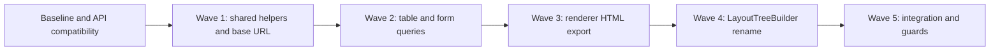

# Transition Roadmap: Modernizing Broiler.HTML with Broiler.DOM

**Date / source recheck:** 2026-10-15  
**Status:** Proposed implementation plan, corrected against the current checkout.  
**Scope:** Consolidate duplicated HTML queries and serialization mechanics, then clarify the role of `DomParser`. This documentation update does not implement the waves below.

The [architecture investigation](architecture/dom-html-layout-investigation.md) records source evidence, API limitations, and the focused test result. It supersedes earlier claims that parsed template bases currently leak into the renderer, that row-alignment inheritance misses `th`, and that a direct `CssBox` serializer adapter preserves HTML export behavior.

## 1. Goals and Preconditions

`Broiler.DOM` owns DOM trees, HTML parsing, and shared queries; `Broiler.CSS` owns CSS syntax and cascade calculation; `Broiler.Layout` owns the box types and core layout algorithms. `Broiler.HTML` projects DOM into boxes, coordinates style and resources, supplies renderer-specific sizing/normalization, and paints the result. This transition should preserve those distinctions.

Before implementing a wave:

1. Record the source revisions, consumed package versions, test totals, and relevant rendering baseline. Avoid fixed claims such as “82+ renderer tests.”
2. Verify the actual dependency closure. [HTML package pins](../Broiler.HTML/Directory.Packages.props) currently select `Broiler.Dom.Html` `0.1.0-preview.14`, `Broiler.Layout` `0.1.0-preview.23`, and CSS packages `0.1.0-preview.17`. Changes to sibling component source must be packed and consumed through the downstream package configuration before an HTML test run can verify them.
3. Add focused regression cases for each behavior being changed, including intentional differences from the old renderer. Keep renderer defaults and selection policy separate from DOM attribute queries.
4. Treat base-URL and serialization conformance gaps as prerequisites to those migrations, not as already-solved properties of the shared APIs.



Every wave includes focused verification. Wave 5 is the final integration check, not the first testing step. The mechanical rename may be delivered separately once its baseline is stable.

## 2. Wave 1: Shared Helpers and Document Base URL

**Owners:** `Broiler.HTML.Core`, `Broiler.HTML.Dom`, `Broiler.HTML.Orchestration`; `Broiler.Dom.Html` where shared semantics need correction.

### Void-element classification

- Replace the duplicated `HtmlUtils.IsSingleTag` list with the shared `HtmlSerializer.VoidElements` classification at an appropriate dependency boundary. `HTML.Dom` already directly references `Broiler.Dom.Html`; `HTML.Core`, where `HtmlUtils` lives, does not. Choose relocation or an explicit package reference rather than assuming the import is free.
- Cover case sensitivity and the different treatment of legacy names, including `basefont` and `isindex`. The shared set also omits `basefont`, `bgsound`, and `keygen` from the standard's serialization-void list; resolve shared-set gaps before claiming conformance. Preserve or deliberately change compatibility behavior; do not describe the sets as identical or claim a benchmarked speedup. See [WHATWG fragment serialization](https://html.spec.whatwg.org/multipage/parsing.html#serialising-html-fragments).

### Progress / meter

- Delegate source-backed ratio calculations to `HtmlElementQueries.ResolveProgressLikeValueRatio`, passing the normalized `meter` or `progress` tag; define behavior for synthetic boxes without `SourceElement`.
- Keep renderer geometry, fill-box creation, and styling in HTML. Test missing/invalid values, nonfinite numbers, clamping, and unusual min/max ranges against the intended behavior.
- `ReadNumericAttribute` is also used by multiple-select sizing. Remove it only after that caller is migrated in Wave 2, not as a Wave 1 exit condition.

### Document base URL

- Consolidate base-element selection on the canonical document for **both** string and `DomDocument` entry points, before resource-dependent work. Prefer resolving once before box projection, with the resolved value explicitly carried into later orchestration.
- First address the shared query's contract: `GetEffectiveBaseHref` returns a nonblank trimmed string, not a `Uri`, and currently skips empty `href` values. Specify and test first-element semantics, including empty, whitespace-only, invalid, and fallback-equal candidates followed by another base. A later base must not be selected merely because the first resolves to the fallback. Reference: [WHATWG document base URLs](https://html.spec.whatwg.org/multipage/urls-and-fetching.html#document-base-url).
- Retain URI resolution/fallback policy and propagation to `CssBox.BaseUrl`, `HtmlContainerInt.DocumentBaseUrl`, linked stylesheets, images, and inline CSS URLs. Update `HtmlParserDump.DumpResourceLogAsJson` as well as `DomParser.PrepareCssTree` before retiring the box scanner.
- Preserve the established exclusion of parsed template contents. Add coverage for bridge-supplied DOM, bound-document rebuilds, and nested documents so one document's base cannot accidentally become another's.

**Exit gate:** shared classification and ratio use are verified; first-base behavior and resource resolution are covered on both renderer inputs and resource logs; affected renderer tests pass against the intended packages. Template exclusion is a regression guard, not a newly proven renderer fix.

## 3. Wave 2: Table and Form Queries

**Owners:** `Broiler.HTML.Dom`, `Broiler.HTML.Orchestration`.

### Table hints

- Replace `SetForAllCells`' depth-based box loops with `HtmlElementQueries.CollectTableRows` and `HtmlTableOperations.GetRowCells`, using a scoped element-to-box mapping before normalization changes the tree. Do not repeatedly scan the whole box tree for each cell.
- The current bug is structural: the direct `td` branch and unfiltered third-level branch treat direct and sectioned headers differently and can touch non-cell boxes. Canonical rows cover header, direct/body, and footer rows; row cells include both `td` and `th`.
- Preserve `InheritRowAlignment`, which already supports `td`, `th`, and `tr`. Verify parent hint inheritance and cell/author overrides independently of traversal consolidation.
- Test direct rows supplied through a DOM, parser-inserted sections, multiple sections, nested tables, both cell types, and non-cell children. Check `border`, `cellpadding`, `align`, and `valign` against UA and author CSS.

### Input text

- Use `HtmlFormQueries.GetDefaultValue` only for markup-default reflection. It returns an empty string for an input without `value`; it does not provide Submit/Reset labels or current edited values.
- Preserve the distinction between a missing `value` and `value=""`, the renderer's input-type allowlist for text, and existing button labels. Use `IsRadioInput` / `IsCheckboxInput` where type predicates are actually needed; neither implements label generation.

### Multiple-select fallback

- Use `HtmlSelectQueries.GetSize` with an explicit renderer fallback (`4`) before the 2–8 track clamp. Its result `0` conflates missing, malformed, zero, and negative attributes; the old numeric reader does not treat all those alike. Preserving those distinctions needs additional attribute information, or an intentional behavior change. Decide and test fractional, negative, zero, malformed, and oversized values before removing the old reader.
- Use `GetOptions` for option semantics where needed, but retain box-level hiding and fallback construction. The current implementation hides all immediate children, including optgroups/text, and paints generic rows; option enumeration alone does not implement selected-option labels or native widget behavior.
- Remove the local numeric reader once no callers remain.

**Exit gate:** table hints reach the intended cells without crossing nested-table boundaries; form labels and select geometry retain documented defaults; any intentional behavior change has focused renderer coverage; affected suites pass without new warnings attributable to the change.

## 4. Wave 3: HTML Export Through the Shared Serializer

**Owner:** `Broiler.HTML.Dom.Utils`, with `Broiler.Dom.Html` API changes only where required.

### Establish the export contract

`DomUtils.GenerateHtml` is used for full rendered HTML and selected HTML. Before replacing its writer, cover:

- `HtmlGenerationStyle.None`, `Inline`, and `InHeader`, including authored inline declarations and header stylesheet injection.
- Selected-word slicing, rendered whitespace, ancestor/element filtering, and `<!--StartFragment-->` / `<!--EndFragment-->` placement.
- Anonymous wrappers, elements with both words and child boxes, void tags, raw-text elements, and escaping in text and attributes.
- Null roots, special `link` filtering, existing doctype omission, and the limits of box export: original comments and template contents are already absent. Full DOM serialization is a separate contract.

### Design a serialization view

Create a renderer export view capable of representing fragment, element, text, and synthetic comment nodes. A direct adapter over `CssBox` with `GetChildren = box.Boxes` and `GetText = box.Text` is insufficient: the old writer emits rendered words, and the shared serializer does not emit an element's `GetText` when it has children.

The actual `HtmlSerializationAdapter<TNode>` constructor requires:

| Delegate | Required behavior in the renderer view |
| :--- | :--- |
| `GetKind` | Distinguish elements, explicit text nodes, synthetic fragment comments, and transparent fragments for anonymous roots/wrappers. |
| `GetName` | Supply the element name; non-element nodes may return an empty string. |
| `GetChildren` | Return the filtered export sequence, including rendered text and synthesized header/fragment nodes where needed. |
| `GetAttributes` | Return a non-null sequence; coordinate `style` with `GetStyles` to prevent duplicate attributes. |
| `GetStyles` | Supply the style declarations required by the selected mode, or an empty sequence. |
| `GetText` | Supply correctly sliced/rendered text or comment contents. |
| `GetRawInnerHtml` | Prefer null; raw markup bypasses escaping and is not a substitute for constructing export nodes. |

Call `HtmlSerializer.Serialize` only after that view preserves the chosen export contract. Keep text encoding enabled. Test raw-text and namespace behavior explicitly: the generic API has no namespace or scripting-mode callback, so tag-name matching alone cannot justify a promise of complete standard conformance. Reference: [WHATWG fragment serialization](https://html.spec.whatwg.org/multipage/parsing.html#serialising-html-fragments).

The shared serializer uses an explicit stack and `MaximumDepth`. Convert recursive selection/preparation walks too before describing the entire path as stack-safe. `HtmlParserDump`'s JSON diagnostics are outside this writer migration.

**Exit gate:** full and selected HTML pass behavioral comparisons for every style mode; intentional escaping/raw-text corrections are separately asserted; deep-tree coverage includes export preparation as well as serialization; no promise of reconstructing source markup is made.

## 5. Wave 4: Rename `DomParser` to `LayoutTreeBuilder`

**Owner:** `Broiler.HTML.Orchestration`.

- Rename the internal class/file and both `GenerateCssTree` overloads to `BuildLayoutTree`, preserving HTML-string and `DomDocument` inputs.
- Update both construction/call sites in `HtmlContainerInt`, including the bound-document rebuild path.
- Update references in `IStylesheetLoader`, `SharedRendererCascade`, `PaintWalker.Text`, and `CssDefaults`. Search the whole repository for code, XML documentation, and explanatory references; historical references may remain when clearly marked.
- A namespace/directory move from `Parse` to `LayoutTree` is optional and should be scoped separately from the mechanical rename. Other types still live in `Parse`.
- Describe the class as coordinating DOM-to-box projection, cascade projection, presentational hints, and renderer box normalization before core layout. Do not imply that it only accepts an already-built DOM or performs all layout itself.

Suggested class summary:

```csharp
/// <summary>
/// Builds a styled layout box tree from HTML or a canonical DomDocument.
/// Delegates HTML parsing and initial box projection, coordinates the CSS
/// cascade and presentational hints, and prepares boxes for layout.
/// </summary>
```

**Exit gate:** no active implementation type or call site retains the old name; both input paths and rebuilds compile and pass their tests; no public API change is claimed merely from renaming this internal type.

## 6. Wave 5: Integration Verification and Architecture Guards

**Owners:** HTML, DOM, CSS, and Layout tests.

Run the relevant component suites against the intended dependency versions, recording discovered/executed totals and skips:

| Suite | Project / runner |
| :--- | :--- |
| Renderer | `Broiler.HTML/tests/Broiler.HTML.Tests/Broiler.HTML.Tests.csproj` |
| DOM nodes | `Broiler.DOM/Broiler.Dom.Tests/Broiler.Dom.Tests.csproj` |
| HTML queries/parser/serializer | `Broiler.DOM/Broiler.Dom.Html.Tests/Broiler.Dom.Html.Tests.csproj` |
| CSS | `Broiler.CSS/Broiler.CSS.Tests/Broiler.CSS.Tests.csproj` |
| DOM cascade | `Broiler.CSS/Broiler.CSS.Dom.Tests/Broiler.CSS.Dom.Tests.csproj` |
| Layout | `Broiler.Layout/Broiler.Layout.Tests/Broiler.Layout.Tests.csproj`; follow `Broiler.Layout/eng/run-tests.ps1` and its minimum-test-count guard |

Use the platform matrix supported by the components, including Windows and Linux. Run affected WPT/render comparisons with recorded baseline, scope, and thresholds. Existing visual failures must be reported and compared; a documentation-only recheck cannot promise every WPT case passes. Routine HTML CI and manually dispatched parser/visual workflows are distinct checks.

Add narrowly scoped architecture guards after each migration lands, building on existing dependency/public-surface tests in DOM, CSS, and Layout:

- Verify the chosen shared void-classification call path and retired local helper, without banning all tag sets (renderer-specific classifications remain legitimate).
- Preserve canonical quirks classification where HTML classifies source; the bound-document path intentionally consumes host-published mode, so do not require every path to call `IsQuirksMode` directly.
- Detect reintroduction of the retired box-based base selector or ratio parser at their former implementation points, supported by behavioral regression tests.
- Assert the absence of the old `DomParser` implementation type after the rename. Historical documentation is not an architectural violation.

An `ArchitectureBoundaryTests` class in HTML is proposed work, not an existing safeguard. Avoid relying solely on a private field name such as `_list` to prove absence of duplication.

**Final exit gate:** affected functional tests and architecture guards pass, intended package versions are verified, visual baselines show no unexplained regressions, and supported CI jobs complete. The [investigation's verification record](architecture/dom-html-layout-investigation.md#6-verification-record) records the narrower checks actually performed during this documentation recheck.
