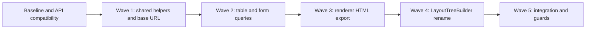

# Transition Roadmap: Modernizing Broiler.HTML with Broiler.DOM

**Date / source recheck:** 2026-10-15  
**Status:** Waves 1, 2 and 4 and the Wave 5 guards are merged (`Broiler.HTML` #252, `Broiler.DOM` #32, and the cleanup in #253). Wave 3 is implemented on `Broiler.HTML` branch `claude/dom-html-wave3`. It waits for a `Broiler.Dom.Html` release (`0.1.0-preview.16`) that carries `Broiler.DOM` #33 and #34. The [implementation record](#7-implementation-record) lists what changed, the decisions taken, and what was verified.  
**Scope:** Consolidate duplicated HTML queries and serialization mechanics, then clarify the role of `DomParser` (now `LayoutTreeBuilder`).

The [architecture investigation](architecture/dom-html-layout-investigation.md) records source evidence, API limitations, and the focused test result. It supersedes earlier claims that parsed template bases currently leak into the renderer, that row-alignment inheritance misses `th`, and that a direct `CssBox` serializer adapter preserves HTML export behavior.

## 1. Goals and Preconditions

`Broiler.DOM` owns DOM trees, HTML parsing, and shared queries; `Broiler.CSS` owns CSS syntax and cascade calculation; `Broiler.Layout` owns the box types and core layout algorithms. `Broiler.HTML` projects DOM into boxes, coordinates style and resources, supplies renderer-specific sizing/normalization, and paints the result. This transition should preserve those distinctions.

Before implementing a wave:

1. Record the source revisions, consumed package versions, test totals, and relevant rendering baseline. Avoid fixed claims such as “82+ renderer tests.”
2. Verify the actual dependency closure. [HTML package pins](../Broiler.HTML/Directory.Packages.props) currently select `Broiler.Dom.Html` `0.1.0-preview.14`, `Broiler.Layout` `0.1.0-preview.23`, and CSS packages `0.1.0-preview.17`. Changes to sibling component source must be packed and consumed through the downstream package configuration before an HTML test run can verify them. Check the `source` in each restored package's `.nupkg.metadata`: a locally packed build carrying a published version number shadows the published package in the global NuGet cache, along with its dependency ranges.
3. Add focused regression cases for each behavior being changed, including intentional differences from the old renderer. Keep renderer defaults and selection policy separate from DOM attribute queries.
4. Treat base-URL and serialization conformance gaps as prerequisites to those migrations, not as already-solved properties of the shared APIs.



Every wave includes focused verification. Wave 5 is the final integration check, not the first testing step. The mechanical rename may be delivered separately once its baseline is stable.

## 2. Wave 1: Shared Helpers and Document Base URL

**Owners:** `Broiler.HTML.Core`, `Broiler.HTML.Dom`, `Broiler.HTML.Orchestration`; `Broiler.Dom.Html` where shared semantics need correction.

### Void-element classification

- Replace the duplicated `HtmlUtils.IsSingleTag` list with the shared `HtmlSerializer.VoidElements` classification. `HTML.Core`, where the internal `HtmlUtils` lives, has no `Broiler.Dom.Html` reference. However, the helper's only caller is `HtmlParser.AppendCanonicalNode` in `HTML.Dom`, which does. Switch that call site and delete the helper; this needs no new package reference and changes no public API.
- The result becomes `HtmlTag.IsSingle`, which `DomUtils` export, `HtmlParserDump`, and `Broiler.Layout`'s inline-SVG serialization (`FragmentTreeBuilder.SerializeSvgBox`) all read. Cover those consumers, not just the parser.
- Cover case sensitivity and the different treatment of legacy names, including `basefont` and `isindex`. The shared set also omits `basefont`, `bgsound`, and `keygen` from the standard's serialization-void list; resolve shared-set gaps before claiming conformance. Preserve or deliberately change compatibility behavior; do not describe the sets as identical or claim a benchmarked speedup. See [WHATWG fragment serialization](https://html.spec.whatwg.org/multipage/parsing.html#serialising-html-fragments).

### Progress / meter

- Delegate source-backed ratio calculations to `HtmlElementQueries.ResolveProgressLikeValueRatio`, passing the normalized `meter` or `progress` tag; define behavior for synthetic boxes without `SourceElement`.
- Keep renderer geometry, fill-box creation, and styling in HTML. Test missing/invalid values, nonfinite numbers (`value="NaN"` currently yields a NaN ratio in both copies), clamping, and unusual min/max ranges against the intended behavior.
- `ReadNumericAttribute` is also used by multiple-select sizing. Remove it only after that caller is migrated in Wave 2, not as a Wave 1 exit condition. The public `HtmlElementQueries.ReadNumericAttribute` applies the same parsing rule to source-backed elements.

### Document base URL

- Consolidate base-element selection on the canonical document for **both** string and `DomDocument` entry points, before resource-dependent work. Prefer resolving once before box projection, with the resolved value explicitly carried into later orchestration.
- First address the shared query's contract: `GetEffectiveBaseHref` returns a nonblank trimmed string, not a `Uri`, and currently skips empty `href` values. Specify and test first-element semantics, including empty, whitespace-only, invalid, and fallback-equal candidates followed by another base. A later base must not be selected merely because the first resolves to the fallback. Reference: [WHATWG document base URLs](https://html.spec.whatwg.org/multipage/urls-and-fetching.html#document-base-url).
- Retain URI resolution/fallback policy and propagation to `CssBox.BaseUrl`, `HtmlContainerInt.DocumentBaseUrl`, linked stylesheets, images, and inline CSS URLs. Update `HtmlParserDump.DumpResourceLogAsJson` as well as `DomParser.PrepareCssTree` before retiring the box scanner.
- Preserve the established exclusion of parsed template contents. Add coverage for bridge-supplied DOM and bound-document rebuilds.
- Fix the nested-document boundary rather than only guarding it. The current box scanner walks into projected nested-browsing-context subtrees, so a sub-document's `<base>` can become the outer document's base. Decide where a nested document's own base comes from, and make sure the replacement query stops at the same boundary.

**Exit gate:** shared classification and ratio use are verified; first-base behavior and resource resolution are covered on both renderer inputs and resource logs; a nested document's `<base>` no longer reaches its parent; affected renderer tests pass against the intended packages. Template exclusion is a regression guard, not a newly proven renderer fix.

**Status:** implemented; the exit gate is met against both `Broiler.Dom.Html` `0.1.0-preview.14` and a local pack of the DOM prerequisites. See [§7](#wave-1-outcome).

## 3. Wave 2: Table and Form Queries

**Owners:** `Broiler.HTML.Dom`, `Broiler.HTML.Orchestration`.

### Table hints

- Replace `SetForAllCells`' depth-based box loops with `HtmlElementQueries.CollectTableRows` and `HtmlTableOperations.GetRowCells`, using a scoped element-to-box mapping before normalization changes the tree. Do not repeatedly scan the whole box tree for each cell.
- The current bug is structural: the direct `td` branch and unfiltered third-level branch treat direct and sectioned headers differently and can touch non-cell boxes. Canonical rows cover header, direct/body, and footer rows; row cells include both `td` and `th`.
- Preserve `InheritRowAlignment`, which already supports `td`, `th`, and `tr`. Verify parent hint inheritance and cell/author overrides independently of traversal consolidation.
- Test direct rows supplied through a DOM, parser-inserted sections, multiple sections, nested tables, both cell types, and non-cell children. Check `border`, `cellpadding`, `align`, and `valign` against UA and author CSS.

### Input text

- Use `HtmlFormQueries.GetDefaultValue` only for markup-default reflection. It returns an empty string for an input without `value`; it does not provide Submit/Reset labels or current edited values.
- Preserve the distinction between a missing `value` and `value=""`, the renderer's input-type allowlist for text, and existing button labels. Use `IsRadioInput` / `IsCheckboxInput` where type predicates are actually needed; neither implements label generation.

### Multiple-select fallback

- Choose between keeping the behavior and changing it.
  - **Keep it:** `HtmlElementQueries.ReadNumericAttribute(select, "size", 4)` uses the same parsing rule as the local reader, so the result is unchanged before the 2–8 track clamp.
  - **Change it:** `HtmlSelectQueries.GetSize` with an explicit renderer fallback (`4`). Its result `0` conflates missing, malformed, zero, negative, and fractional attributes, so `size="0"` and `size="2.5"` would render four tracks instead of today's two.
- Decide and test fractional, negative, zero, malformed, and oversized values before removing the old reader.
- Use `GetOptions` for option semantics where needed, but retain box-level hiding and fallback construction. The current implementation hides all immediate children, including optgroups/text, and paints generic rows; option enumeration alone does not implement selected-option labels or native widget behavior.
- Remove the local numeric reader once no callers remain.

**Exit gate:** table hints reach the intended cells without crossing nested-table boundaries; form labels and select geometry retain documented defaults; any intentional behavior change has focused renderer coverage; affected suites pass without new warnings attributable to the change.

**Status:** implemented, keeping today's select sizing. See [§7](#wave-2-outcome).

## 4. Wave 3: HTML Export Through the Shared Serializer

**Owner:** `Broiler.HTML.Dom.Utils`, with `Broiler.Dom.Html` API changes only where required.

### Establish the export contract

`DomUtils.GenerateHtml` is used for full rendered HTML and selected HTML. Before replacing its writer, cover:

- `HtmlGenerationStyle.None`, `Inline`, and `InHeader`, including authored inline declarations and header stylesheet injection.
- Selected-word slicing, rendered whitespace, ancestor/element filtering, and `<!--StartFragment-->` / `<!--EndFragment-->` placement.
- Anonymous wrappers, elements with both words and child boxes, void tags (the renderer writes `/>`, the shared serializer `>`), raw-text elements, and escaping in text and attributes.
- `InHeader`'s extra `<head>`, inserted after `<html>` ahead of the document's own head.
- Null roots, special `link` filtering, existing doctype omission, and the limits of box export: original comments and template contents are already absent. Full DOM serialization is a separate contract.

### Design a serialization view

Create a renderer export view capable of representing fragment, element, text, and synthetic comment nodes. A direct adapter over `CssBox` with `GetChildren = box.Boxes` and `GetText = box.Text` is insufficient: the old writer emits rendered words, and the shared serializer does not emit an element's `GetText` when it has children.

The actual `HtmlSerializationAdapter<TNode>` constructor requires:

| Delegate | Required behavior in the renderer view |
| :--- | :--- |
| `GetKind` | Distinguish elements, explicit text nodes, synthetic fragment comments, and transparent fragments for anonymous roots/wrappers. |
| `GetName` | Supply the element name; non-element nodes may return an empty string. |
| `GetChildren` | Return the filtered export sequence, including rendered text and synthesized header/fragment nodes where needed. |
| `GetAttributes` | Return a non-null sequence; coordinate `style` with `GetStyles` to prevent duplicate attributes. |
| `GetStyles` | Supply the style declarations required by the selected mode, or an empty sequence. |
| `GetText` | Supply correctly sliced/rendered text or comment contents. |
| `GetRawInnerHtml` | Prefer null; raw markup bypasses escaping and is not a substitute for constructing export nodes. |
| `GetNamespace` (optional, init-only; not yet released, see [§7](#wave-3-prerequisites)) | Supply each element's namespace from its box's `SourceElement`, and treat a synthetic box without one as HTML. Setting it keeps `foreignObject` and `linearGradient` in their case, stops an SVG `link` being written as void, and escapes the text of an SVG `style`. |

Call `HtmlSerializer.Serialize` only after that view preserves the chosen export contract. Keep text encoding enabled. Test raw-text and namespace behavior explicitly. The published API has no namespace callback and lowercases every element name, which affects inline-SVG names such as `foreignObject`; the namespace input in §7 fixes that once it is released. There is still no scripting-mode callback, so `noscript` is always raw text. Reference: [WHATWG fragment serialization](https://html.spec.whatwg.org/multipage/parsing.html#serialising-html-fragments).

The shared serializer uses an explicit stack and `MaximumDepth`. Convert recursive selection/preparation walks too before describing the entire path as stack-safe. `HtmlParserDump`'s JSON diagnostics are outside this writer migration.

**Exit gate:** full and selected HTML pass behavioral comparisons for every style mode; intentional escaping/raw-text corrections are separately asserted; deep-tree coverage includes export preparation as well as serialization; no promise of reconstructing source markup is made.

**Status:** implemented on `Broiler.HTML` branch `claude/dom-html-wave3`, verified against a local pack of the DOM release it needs. It merges after `Broiler.Dom.Html` `0.1.0-preview.16` is published and its pin is bumped. See [§7](#wave-3-outcome).

## 5. Wave 4: Rename `DomParser` to `LayoutTreeBuilder`

**Owner:** `Broiler.HTML.Orchestration`.

- Rename the internal class/file and both `GenerateCssTree` overloads to `BuildLayoutTree`, preserving HTML-string and `DomDocument` inputs.
- Update both construction/call sites in `HtmlContainerInt`, including the bound-document rebuild path.
- Update references in `IStylesheetLoader`, `SharedRendererCascade` (a `<see cref="DomParser"/>` the compiler resolves), `PaintWalker.Text`, and `CssDefaults`. Search the whole repository for code, XML documentation, and explanatory references; historical references may remain when clearly marked.
- Comment-only mentions also exist in other components: `Broiler.Layout` engine sources and tests, `Broiler.DOM`'s `HtmlDocumentParser`, and this repository's `src/` (`Broiler.Headless`, `Broiler.Wpt`, `Broiler.Cli.Tests`). There are also historical mentions under `docs/`. None of them is a code or reflection reference, so they can follow in each component's own change.
- A namespace/directory move from `Parse` to `LayoutTree` is optional and should be scoped separately from the mechanical rename. Other types still live in `Parse`.
- Describe the class as coordinating DOM-to-box projection, cascade projection, presentational hints, and renderer box normalization before core layout. Do not imply that it only accepts an already-built DOM or performs all layout itself.

Suggested class summary:

```csharp
/// <summary>
/// Builds a styled layout box tree from HTML or a canonical DomDocument.
/// Delegates HTML parsing and initial box projection, coordinates the CSS
/// cascade and presentational hints, and prepares boxes for layout.
/// </summary>
```

**Exit gate:** no active implementation type or call site retains the old name; both input paths and rebuilds compile and pass their tests; no public API change is claimed merely from renaming this internal type.

**Status:** implemented in `Broiler.HTML` and in this repository's `src/` comments. The comment-only mentions in `Broiler.Layout`, `Broiler.HtmlBridge` and `Broiler.DOM` are left for those components' own changes.

## 6. Wave 5: Integration Verification and Architecture Guards

**Owners:** HTML, DOM, CSS, and Layout tests.

Run the relevant component suites against the intended dependency versions, recording discovered/executed totals and skips:

| Suite | Project / runner |
| :--- | :--- |
| Renderer | `Broiler.HTML/tests/Broiler.HTML.Tests/Broiler.HTML.Tests.csproj` |
| DOM nodes | `Broiler.DOM/Broiler.Dom.Tests/Broiler.Dom.Tests.csproj` |
| HTML queries/parser/serializer | `Broiler.DOM/Broiler.Dom.Html.Tests/Broiler.Dom.Html.Tests.csproj` |
| CSS | `Broiler.CSS/Broiler.CSS.Tests/Broiler.CSS.Tests.csproj` |
| DOM cascade | `Broiler.CSS/Broiler.CSS.Dom.Tests/Broiler.CSS.Dom.Tests.csproj` |
| Layout | `Broiler.Layout/Broiler.Layout.Tests/Broiler.Layout.Tests.csproj`; follow `Broiler.Layout/eng/run-tests.ps1` and its minimum-test-count guard |

Use the platform matrix supported by the components, including Windows and Linux. Run affected WPT/render comparisons with recorded baseline, scope, and thresholds. Existing visual failures must be reported and compared; a documentation-only recheck cannot promise every WPT case passes. Routine HTML CI and manually dispatched parser/visual workflows are distinct checks.

Add narrowly scoped architecture guards after each migration lands, building on existing dependency/public-surface tests in DOM, CSS, and Layout:

- Verify the chosen shared void-classification call path and retired local helper, without banning all tag sets (renderer-specific classifications remain legitimate).
- Preserve canonical quirks classification where HTML classifies source; the bound-document path intentionally consumes host-published mode, so do not require every path to call `IsQuirksMode` directly.
- Detect reintroduction of the retired box-based base selector or ratio parser at their former implementation points, supported by behavioral regression tests.
- Assert the absence of the old `DomParser` implementation type after the rename. Historical documentation is not an architectural violation.

`Broiler.HTML`'s `ArchitectureBoundaryTests` carries the guards for the void list, the box-tree base selector, the ratio/numeric reader and the rename. On the Wave 3 branch it also guards the export writer and the single `BuildLayoutTree(DomDocument)` input, which reflects the single parse. A guard on quirks classification is still to come. Avoid relying solely on a private field name such as `_list` to prove absence of duplication.

**Final exit gate:** affected functional tests and architecture guards pass, intended package versions are verified, visual baselines show no unexplained regressions, and supported CI jobs complete. The [investigation's verification record](architecture/dom-html-layout-investigation.md#6-verification-record) records the narrower checks actually performed during this documentation recheck.

## 7. Implementation Record

**Branches:** `claude/dom-html-transition` in `Broiler.HTML` (one commit per wave, plus the guards) and `claude/dom-html-transition-wave1` in `Broiler.DOM` (the shared-semantics prerequisites, commit "Parse and serialize basefont, bgsound and keygen as void, and read only finite numbers"). `claude/namespace-aware-serializer` in `Broiler.DOM` builds on the wave1 branch with the Wave 3 serializer prerequisite (see [below](#wave-3-prerequisites)), `claude/foreign-content-parsing` builds on that with the parser prerequisite, `claude/foreign-fragment-context` builds on the parser branch with fragment parsing in an SVG or MathML context, and `claude/fragment-title-in-place` builds on the fragment branch with an HTML `<title>` kept where it is written once the body has started. This repository's `Broiler.DOM` pointer is at the tip of `claude/fragment-title-in-place`. `Broiler.HTML` still pins `Broiler.Dom.Html` `0.1.0-preview.14`, so its waves work on the published package. The DOM prerequisites reach the renderer only after a DOM release that contains them, followed by a pin bump in `Broiler.HTML`.

### Wave 1 outcome

- **Void classification.** `HtmlParser.AppendCanonicalNode` takes `HtmlTag.IsSingle` from `HtmlSerializer.VoidElements`, and `HtmlUtils` is deleted. The renderer therefore classifies elements as the tree builder that built them did. Under `preview.14`, `basefont`, `bgsound` and `keygen` are not single, and that parser does not close them either. The DOM prerequisite adds all three to the shared set: the tree builder now inserts and immediately pops them, `basefont` and `bgsound` stay in the head, and the serializer writes no end tag for them. `isindex` is an ordinary element in both. The `/>` versus `>` difference in the renderer's export is Wave 3's.
- **Progress / meter.** `ResolveProgressValueRatio` delegates to `HtmlElementQueries.ResolveProgressLikeValueRatio`. A box without a `SourceElement` (the projection gives every element box one, so only a synthesised box) draws an empty bar. The DOM prerequisite makes `ReadNumericAttribute` reject `NaN`, `Infinity` and overflowing literals, and makes the ratio 0 when extreme finite bounds overflow. Until that release is consumed, `value="Infinity"` still fills a progress bar under `preview.14`, and `value="NaN"` still yields a NaN ratio, which lays out as an empty fill. The full HTML floating-point parsing rules (for example, accepting trailing garbage such as `5px`) are not implemented by either copy.
- **Document base URL.** `DocumentBaseUrl.Resolve(DomNode, Uri)` reads the canonical DOM before any box exists. It selects the first HTML `<base>` with an `href`, whatever the value is. It freezes an empty, whitespace-only, unparsable, `data:` or `javascript:` value to the fallback, and that frozen value still hides any later base. It does not descend into a nested document root. `HtmlParser.ParseDocument(..., out documentBaseUrl)` resolves the document's base and builds every box against it. A nested sub-document gets its own base, resolved with its parent's base as the fallback; this covers an in-tree `#subdoc-root` and a resolver-supplied content document alike. `LayoutTreeBuilder` carries the value instead of rebasing the tree, and `HtmlParserDump.DumpResourceLogAsJson` reads each box's own base. The leak of a sub-document's base into its parent is now reproduced by a test that fails on the old code.
  - The renderer does not call `HtmlDocumentQueries.GetEffectiveBaseHref`, for two reasons: it skips a blank `href`, which §4.2.3 does not, and it cannot stop at the renderer's nested-document boundary. Aligning that shared query with the standard would also change `Broiler.HtmlBridge`'s callers, so it is a separate DOM change.
  - Still open: a nested document's `<link rel=stylesheet>` resolves at the container level, against the outer document's base, as it did before.

### Wave 2 outcome

- **Table hints.** `SetForAllCells` asks `CollectTableRows` / `GetRowCells` for the table's cells. It maps them to boxes in one walk over the table's own three levels, before the box fix-ups. A `th` in a direct row is now padded itself, not its children. Caption content and the text between cells are no longer styled as cells, and a nested table's cells stay its own. `InheritRowAlignment` is unchanged.
- **Toggles.** `IsNativelyDrawnToggle` uses `IsCheckboxInput` / `IsRadioInput`. `type=" checkbox "` is now a text field here too, as it already was for the user-agent sheet.
- **Multiple select.** Kept: `HtmlElementQueries.ReadNumericAttribute(select, "size", 4)`, clamped to 2–8. The renderer's own numeric reader is deleted. After the DOM prerequisite, `size="Infinity"` gives four tracks instead of eight.
- **Input text.** Unchanged. `GetDefaultValue` cannot distinguish a missing `value` from `value=""`, and no shared query supplies the Submit/Reset labels or the text-type allowlist, so tests now pin that policy instead.

### Cleanup after Waves 1, 2 and 4

A later sweep of `Broiler.HTML` for DOM semantics it still computes itself found three defects, fixed on `Broiler.HTML` branch `claude/dom-html-cleanup`:

- **A nested document's style sheets stayed in the parent.** `LayoutTreeBuilder.CascadeParseStyles` walked every box, including the sub-viewports projected under an `<iframe>`, into one style set, and both documents were cascaded with it. An iframe's `p { color: red }` turned the parent page's paragraphs red, and the parent's sheets styled the iframe. This is the same nested-boundary leak the base URL had. The walk now stops at a nested document root. `ApplyNestedDocumentStyles` cascades each sub-document with its own style set: the document-independent sheets (user-agent and embedder CSS) plus the sub-document's own, through engines built for its document. Limitations kept:
  - The sub-document's media queries still see the container's viewport, not the frame's box.
  - Its `<link rel=stylesheet>` still resolves against the outer document's base (see Wave 1).
  - `@position-try` rules (`HtmlContainerInt.CollectPositionTryRules`) are still collected across documents.
- **`GetElementRectangle(id)` matched ids case-insensitively.** It lowercased the id and compared without case, so `"box"` found `id="Box"`. In-page fragment navigation and the browser's form-control host go through it. It now asks the canonical document's `GetElementById` and maps the element to its box. An id the document does not hold is still looked up, now case-sensitively, in the boxes of its nested sub-documents.
- **Every button submitted, and only to an enclosing form.** The click fallback treated every `<button>` and `<input type=button|reset>` as a submit button. It found the form by walking up the box tree, ignored `formaction`, and reported the base URL for an empty action. It now recognizes a submit button by its type state (HTML §4.10.6): a missing or invalid `type` is a submit button, and `button` and `reset` are not. The form owner comes from `HtmlFormQueries.GetFormOwner`, so `form="id"` is honored. The URL is the button's `formaction`, else the form's `action`, else the document's URL (§4.10.21.3). `<input type=image>` is classified as a submit button, but `Broiler.Layout`'s `CssBox.IsClickable` does not yet let a click on one reach this path.

Verification:
- `Broiler.HTML`: 229 passed, 0 failed, on `preview.14`. The 19 new tests are in `NestedDocumentStyleTests`, `ElementRectangleIdTests` and `FormSubmitTargetTests`; 14 of them fail on the code they replace, and the other 5 pin plain submit cases.
- This repository's `src/Broiler.Cli.Tests`: 4,045 passed / 185 failed, against 4,043 / 187 without the fixes. No test fails only with them; the two that failed only without them are a fetch-promise test and an idle-callback timing test.

The rest of the sweep is handled in the next section.

### Follow-ups to the sweep

- **Typed values** (`Broiler.HTML` `claude/dom-html-followups`). Typing sets the control's dirty value (HTML §4.10.5.4, §4.10.11) in the container's new `FormState`, an `HtmlFormState` a host can share. The element's `value` attribute and a textarea's text are its default value, and typing no longer rewrites them. The projection shows the dirty value, so it survives `RestyleDocument`. The renderer's own export still writes the typed value, because the box's attribute copy carries it.
- **`rel` tokens** (same branch) are split on ASCII whitespace (`HtmlLinkTypes`), for the stylesheet collection and the resource log.
- **`Broiler.Dom.Html` `0.1.0-preview.15`** (same branch) is now the pin. It carries Wave 1's void and numeric fixes.
- **Input types and the document mode** (`Broiler.DOM` #34; `Broiler.HTML` `claude/dom-html-wave3`).
  - `HtmlFormQueries.GetInputType` maps a `type` attribute to its state keyword, and `"text"` for a missing or invalid value. The renderer's three type lists read it, so `type="foo"` is a text field.
  - `HtmlDocumentParseResult.IsQuirksMode` reports the tree builder's mode decision. `SetHtmlWithStyleSet` now parses once, publishes that mode, and hands the parsed document to `LayoutTreeBuilder`, whose HTML-string overload is gone. Before, it tokenized the source a second time through `IsQuirksMode(string)`.
  - `SharedRendererCascade.FindCanonicalDocument` was looked at and left as it is: it returns at the first element box, so it is not a tree walk worth removing.
- **Spans** (`Broiler.Layout` `claude/html-span-attributes`). `colspan` and `rowspan` are read as HTML's non-negative integers and clamped to 1–1000 and 1–65534 (`HtmlTableSpans`). One cell with `colspan="3000000"` used to make the layout allocate 137 MiB. `rowspan="0"` is still a single row, where HTML spans it to the end of the row group.
- **The per-box attribute copy is kept, on purpose.** `HtmlTag`'s dictionary is the render tree's snapshot of the element's attributes. Layout and paint can run on other threads while a script mutates the DOM, and reading attributes live would bring back the cross-thread races the DOM's child-list snapshots were added for. The drift the copy showed came from writes into the DOM (typed values), and those are gone. Reading through `SourceElement` instead would need an immutable attribute snapshot in `Broiler.DOM` first.

### Wave 3 outcome

Implemented on `Broiler.HTML` branch `claude/dom-html-wave3`, against a local pack of `Broiler.DOM` #34 (which carries #33).

- `DomUtils.GenerateHtml` delegates to `RendererHtmlExport`, which builds a view of the rendered boxes as element, text and comment nodes and serializes it with `HtmlSerializer.Serialize<TNode>`. The view sets `GetNamespace` from each box's `SourceElement`.
- The export's own policy stays in the view:
  - rendered words, not source text;
  - selection slicing and the fragment comments;
  - the `Inline` style attribute and the `InHeader` head;
  - the omitted `property:` and `method:` links.

  Anonymous boxes are transparent, so a `<style>`'s or `<xmp>`'s text is that element's own raw text.
- Corrections, asserted by `HtmlExportContractTests` (seven of whose twelve cases fail on the old writer):
  - void elements end with `>` and keep no children, so an input's generated label is no longer stray text after it;
  - raw-text elements' text is not escaped;
  - the inline `style` attribute has no trailing `;`;
  - the table layout's spacing boxes (`<none colspan="1">`) and nested documents' sub-viewports (`<#subdoc-root>`) are left out.
- The view, the selection collection and the serializer use explicit stacks. The box projection, cascade and layout before them still recurse: 2,000 nested elements overflow the stack in `HtmlParser.AppendCanonicalNode`, before anything is exported.
- `ArchitectureBoundaryTests` guards against the old writer coming back.

Verification of the follow-ups and Wave 3:
- `Broiler.DOM` #34: 191 + 838 passed, 0 failed (45 new).
- `Broiler.Layout` `claude/html-span-attributes`: 3,053 passed, 0 failed (32 new). Both layout-level cases fail on the old span reading, which allocates 137 MiB for `colspan="3000000"`.
- `Broiler.HTML` `claude/dom-html-followups`: 243 passed on the published `preview.15`. `claude/dom-html-wave3`: 265 passed against the local `0.1.0-preview.16-local.1` pack of #34 (feed `D:\local-packages\dom-html-followups-2026-10-15`).
- This repository's `src/Broiler.Cli.Tests`, with all three branches built from source: 4,044 passed / 186 failed, against 4,042 / 188 with the submodules at `main`.
  - Two tests failed only with the branches. The graphics-path test passes when re-run and failed only on the baseline in an earlier comparison. The XHR header test failed in every earlier run, baseline included, and passed only in this run's baseline.
  - No failure is attributable to the changes.

### Wave 3 prerequisites

Before the renderer export can move to `HtmlSerializer.Serialize<TNode>`, `Broiler.Dom.Html` needs the four changes below. The first two are on `Broiler.DOM` branch `claude/namespace-aware-serializer`, commit "Serialize elements by their namespace, not their name alone". That branch is cut from `claude/dom-html-transition-wave1`, so one DOM release can carry both. The third is on `claude/foreign-content-parsing`, commit "Parse inline SVG and MathML as foreign content", which is cut from the serializer branch, and its fragment half on `claude/foreign-fragment-context`, commit "Parse a fragment in an SVG or MathML context as foreign content", cut from the parser branch. A fix for the title placement those fragments exposed is on `claude/fragment-title-in-place`, commit "Insert an HTML title at the current node once the body has started", cut from the fragment branch.

1. **Done: foreign names keep their case.** `HtmlSerializationAdapter<TNode>` has an optional `GetNamespace`. It is an init-only property, not a constructor parameter, so the seven-delegate constructor and `Deconstruct` are unchanged. When it is set, only HTML-namespace names are lowercased, so `foreignObject` and `linearGradient` survive. An adapter that leaves it unset is serialized as before, with every element treated as HTML. The canonical `DomNode` adapter sets it. It also writes the name §13.3 asks for: the local name of an HTML, SVG or MathML element (`svg:rect` becomes `<rect>`), and the qualified name of any other element.
2. **Done: void and raw-text rules apply to HTML-namespace elements only.** An SVG `link` keeps its children and end tag. The text of an SVG `style` is escaped. Before this change it was written raw, so `` inside it would break out of the SVG on a re-parse. The serializer's own `Broiler-Falsified-If` claim described that case, and a test confirmed the claim did not hold. A new overload, `IsRawTextElement(localName, namespaceUri)`, gives the same rule to adapters that escape text themselves.
3. **Done: the parser builds foreign content.** `HtmlDocumentParser` follows HTML §13.2.6.5: `<svg>` and `<math>` and their descendants are SVG and MathML elements, with the SVG tag-name and attribute adjustments (`foreignObject`, `linearGradient`, `viewBox`, …), MathML's `definitionURL`, and `xlink:`, `xml:` and `xmlns` attributes in their namespaces. Integration points hold HTML content, the HTML start tags that cannot appear in foreign content close it, and a self-closing foreign tag opens nothing. During a parse the tokenizer asks the tree builder before it switches to RCDATA or RAWTEXT, so an SVG `style`, `title` or `script` reads as markup with its references decoded, and a CDATA section in foreign content is text. Standalone tokenization, which the token scans use, still switches by name. `Broiler.Dom` gains `DomNamespaces.XLink`, `DomDocument.CreateElement(DomName)` and `DomElement.SetAttribute(DomName, string)`. Its name-based attribute methods now also find an attribute by its qualified name (`xlink:href`) and, on an SVG or MathML element, by a name that differs in ASCII case. They never find less than before, and the spec correction to `getAttribute` stays a separate item (Broiler.DOM `docs/roadmap.md`, D1). Fragments follow HTML §13.4: `HtmlDocumentParser.ParseFragment(string, DomElement[, HtmlParseOptions])` opens a copy of an SVG or MathML context, in its namespace and with its attributes, ahead of the markup instead of a string wrapper, so `g.innerHTML = '<rect/>'` gives an SVG `rect`, a `foreignObject`, `desc`, `title`, HTML-encoded `annotation-xml` or MathML text integration point holds HTML, a breakout tag such as `<p>` is an HTML child of the fragment, CDATA is text, and an SVG `style`, `title` or `script` context starts the tokenizer in the data state. `HtmlFragmentParsing.TryBuildFragment(DomElement, …)` routes SVG and MathML elements there; it used to pass `TagName`. The string overloads still take an HTML element of the name they are given (`svg` and `math` excepted), and so does a context in any other namespace.
4. **Open: a DOM release that contains all five branches.** Publishing is a manual workflow. Neither downstream suite changes, but the bridge must not take that release without its namespace change, described in the next list; see Verification.

What the parser change means downstream:

- **Parsed inline SVG now reaches the renderer with its namespace and camel case.** The box tree takes `element.LocalName` as it stands, so `HtmlTag.Name` is `foreignObject` and `linearGradient`, and attribute keys are `viewBox` and `xlink:href`. Every tag-name comparison in `Broiler.Layout`'s SVG code is case-insensitive (`SvgForeignObjectBoxes` lowercases before it compares, `SvgStructure` and `SvgRenderer` use `OrdinalIgnoreCase` and case-insensitive regexes), the renderer's attribute dictionaries are case-insensitive, and `Broiler.CSS.Dom` matches type and attribute selectors case-insensitively. Three namespace checks now see parsed SVG as foreign: `RenderTreeInvalidation.IsInForeignContent` no longer elides attribute changes under parsed inline SVG, `DocumentBaseUrl.IsHtmlBase` ignores an SVG `<base>`, and `CssSelectorMatcher` keeps its case-insensitive attribute values for HTML elements only. `HtmlTag.IsSingle` is still matched by name alone, so a parsed SVG `link` is single: `<svg><link><rect></svg>` now nests the rect in the link, and the box export writes `<link/>` without it.
- **Done on a branch: `Broiler.HtmlBridge` serializes by namespace before it bumps its pin.** Before the change, the bridge's adapter did not set `GetNamespace`, and `IsRawTextSerializationParent` matched `TagName`, so it wrote the text of an SVG `style` or `script` raw. That text is now decoded, so `&lt;/style&gt;` in it is a literal end tag: with the local pack, `innerHTML` turned `<svg><style>&lt;/style&gt;&lt;img id=x&gt;</style></svg>` into a live `img` after one round trip, and `<svg><script>` did the same. The canonical `DomNode` adapter escapes that text, and a DOM test pins the round trip. The bridge's `document.getElementsByTagName` lowercased the query and compared `TagName` ordinally, so `getElementsByTagName('foreignObject')` found nothing, and its `localName` read `foreignobject` where a browser reads `foreignObject`. Branch `claude/namespace-aware-svg`, commit "Serialize, find and name inline SVG by its namespace", fixes all three, and this repository's pointer is bumped to it; the bridge's pin stays at `preview.14`.
  - Text is written raw only under an HTML-namespace parent. That needs no new API, so it applies on `preview.14` too, where parsed SVG is still HTML and is written as before. The one change there is that the text of a script-built SVG `style` or `script` is now escaped, and `preview.14`'s parser reads it back undecoded. The rule looks at the parent's namespace, not at what parsed the text, so it also closes the fragment case in the next bullet.
  - `GetNamespace` and §13.3's choice of name (the local name of an HTML, SVG or MathML element) need API that `preview.14` lacks. `BROILER_DOM_SERIALIZES_BY_NAMESPACE` compiles them in. The bridge's `Directory.Packages.props` now reads the pin from `BroilerDomHtmlVersion` and defines the constant whenever the pin is not `preview.14`, so the pin bump turns them on. A test fails if the package offers `GetNamespace` while the constant is off. Delete the constant and its `#if` blocks after the bump.
  - `getElementsByTagName` on a document, an element and a frame's document follows DOM §4.4's list of elements with qualified name: an HTML element matches the query ASCII-lowercased, any other element the query as written. `localName` is the element's own local name.
- **The bridge's fragment paths change with the same bump and need no code of their own, except `document.write`.** `innerHTML`, `outerHTML`, `insertAdjacentHTML`, a shadow root's `innerHTML` and `createContextualFragment` all reach `HtmlFragmentParsing.TryBuildFragment(DomElement, …)` (through `TryBuildInnerHtmlFragmentContainer`), so an SVG or MathML context parses as foreign content once the bridge takes the release. `DocumentWriteBinding` passes `scriptParent.TagName.ToLowerInvariant()` to `HtmlDocumentParser.ParseFragment(string, string)`; to give a `document.write` from a script inside an SVG the same rules, it would pass `scriptParent` itself to the `DomElement` overload. The serializer opt-in above covers fragments too: `svgStyle.innerHTML = '&lt;/style&gt;…'` now leaves decoded text in an SVG `style`, where the old tag-name path read it as raw text.
- **Still by name elsewhere.** The token scans and `HtmlDocumentQueries.GetEffectiveBaseHref` still treat an SVG `<base>`, `style` or `script` by name. A fragment context in a namespace other than HTML, SVG or MathML still parses as an HTML element of its name, where §13.4 would treat it as foreign content.
- **An HTML `<title>` stays where it is written once the body has started.** "In body" processes it with the "in head" rules (HTML §13.2.6.4.7), which insert it at the current node, or foster it out of a table, and every fragment whose context is not the `html` or `head` element is past that point. Before the fix every title outside a template went to the head, so `div.innerHTML = '<title>t</title>x'` gave just `x`: the title went to the head of the synthetic document the fragment is parsed in and was lost. The same happened at an SVG `foreignObject`, `desc` or `title` context and a MathML `mi`, and a `<title>` in a document's body moved into its head. A title before the body still goes in the head. The parse result's `Title` is still the first HTML title element in tree order, now settled after the parse, because a title fostered out of a table is placed after it and a later title in one of its cells comes first. The bridge's `innerHTML`, `outerHTML`, `insertAdjacentHTML` and `createContextualFragment` keep a title from the same pin bump.

On the renderer side, the export contract in §4 still has to be characterized first. Selected-HTML tests need a way to set a selection that the test project can reach, since `Broiler.Layout` grants it no internals.

### Verification

- `Broiler.DOM` (`dotnet test Broiler.Dom.slnx -c Release`): 186 + 636 passed, 0 failed. The 636 include 28 new tests. With the namespace-aware serializer on top, the counts are 186 + 660 passed, 0 failed. The 24 new test cases are in `HtmlSerializerNamespaceTests`. The 14 that need no new API were run on the wave1 code first, and 11 of them failed there. That code wrote `<lineargradient>`, `<svg:rect>` and `<x:widget>`, treated an SVG `link`, `img`, `br` and `source` as void, and wrote the text of an SVG `style` and of a MathML `style` or `script` unescaped. The other three pin unchanged HTML behaviour: parsed HTML, lowercased HTML-namespace names, and an adapter without a namespace. They passed before the change and still pass.
- `Broiler.HtmlBridge` (`dotnet test tests/Broiler.HtmlBridge.Tests -c Release`, all 2,356 tests, since it has no separate serializer or `innerHTML` project) gave the same result in four runs: 2,335 passed, 21 skipped, 0 failed. The runs were: (1) the published `preview.14`; (2) those same binaries, not rebuilt, with the new `Broiler.Dom.dll` and `Broiler.Dom.Html.dll` copied over them, which checks binary compatibility; (3) rebuilt against a local `0.1.0-preview.15-local.2` pack of the DOM branch (feed `D:\local-packages\dom-namespace-serializer-2026-10-15`); (4) rebuilt against that pack with an uncommitted change that opts the bridge in, setting `GetNamespace` and switching `IsRawTextSerializationParent` to the namespace overload. Because run 4 also passes, none of the bridge's tests serializes a `createElementNS`-built SVG tree; the bridge change needs its own tests for that.
- Foreign-content parsing (`claude/foreign-content-parsing`): `Broiler.DOM` 191 + 725 passed, 0 failed (5 and 65 new). One existing test changed its expectation: `Parsed_Html_Serializes_As_Before` now reads `<foreignObject>` on both sides. Downstream builds used local packs `0.1.0-preview.15-local.3` and `-local.4` (feed `D:\local-packages\dom-foreign-content-2026-10-15`) against each component's `main`, with an empty `NUGET_PACKAGES` so no cached local build could stand in for a published package. `local.3` made `getAttribute` exact for SVG elements; that was withdrawn for `local.4`, the committed version, because the DOM roadmap defers it. `Broiler.HTML` (a870ddb): 210 passed on `preview.14`, `local.3` and `local.4`. `Broiler.HtmlBridge` (14dd4ba): 2,335 passed, 21 skipped, 0 failed on all three. Neither suite changes, so two uncommitted probes measured the difference. The renderer probe rendered 25 inline SVG and MathML pages: 23 came out pixel-identical, covering gradients, `gradientUnits`/`gradientTransform`, `viewBox`, `preserveAspectRatio`, `clipPath`/`clipPathUnits`, `foreignObject`, `use` with `xlink:href` and `href`, `textPath`, `feGaussianBlur`, `feFlood`, `pattern`, a `title` and MathML. The other two changed. In `<svg><rect/><p>text</p></svg>` the paragraph now follows the SVG, where its text used to be drawn inside it. In `<svg><link><rect/></svg>` the rect is no longer drawn (see `IsSingle` above); a browser does not draw an unknown SVG element's children either. The probe also showed pre-existing gaps that are unchanged: an SVG `style` (with or without CDATA), a `marker`, and a `foreignObject` inside an SVG with a `viewBox` draw nothing. The bridge probe ran 43 script expressions: parsed SVG and MathML now report their namespaces, `tagName` `foreignObject` and `svg`, `viewBox` in `attributes`, `getAttributeNS` for `xlink:href`, decoded SVG `style` text, CDATA as text, HTML children in an SVG `title`, and `instanceof SVGElement`. The regressions are the round trip and the two lookups listed above.
- Fragment parsing in a foreign context (`claude/foreign-fragment-context`): `Broiler.DOM` 191 + 766 passed, 0 failed (41 new, in `ForeignFragmentParsingTests`, several drawn from html5lib-tests' `foreign-fragment.dat`). With the new overload routed back through the tag-name path, 20 of the 41 fail; the other 21 pin results the old path already gave, such as HTML content at an integration point and end tags that never close the context. `Broiler.HtmlBridge` (14dd4ba) against a local `0.1.0-preview.15-local.5` pack of this commit (feed `D:\local-packages\dom-foreign-fragment-2026-10-15`, with no bridge change but the pin): 2,335 passed, 21 skipped, 0 failed, as on `local.4`, so no bridge test sets markup on an SVG or MathML element. An uncommitted probe measured the difference. With `local.4` every one of these built HTML elements; with `local.5`, `innerHTML` on an SVG `g` gives SVG `rect` and `linearGradient` and an HTML `p`, CDATA in it is text, an SVG `title` and a MathML `mi` hold HTML (`mglyph` stays MathML), and `insertAdjacentHTML`, `outerHTML`, a detached `createElementNS` `g` and `createContextualFragment` in a `g` all give SVG elements. It also confirmed the serializer caveat above: `svgStyle.innerHTML = '&lt;/style&gt;&lt;img id=x&gt;'` followed by one `outerHTML`/`innerHTML` round trip creates a live `img` with `local.5` and not with `local.4`, because the old tag-name path read an SVG `style` context as raw text. The bridge's namespace change closes this along with the document-parse case; see the next item.
- Bridge namespace change (`Broiler.HtmlBridge` `claude/namespace-aware-svg`): `InlineSvgNamespaceTests` adds 14 cases. Against `preview.14`, nine run and four are skipped, because they need `GetNamespace` or the foreign-content parser. Against `local.4`, all 14 pass. With the source change reverted, 13 of them fail against `local.4`, the `innerHTML` round trip among them. The one that still passes guards the build constant, not the code. Whole suite, `-c Release`, with `NUGET_PACKAGES` pointed at a cache holding no stale local builds: `preview.14` 2,344 passed, 25 skipped, 0 failed; `local.4` and `local.5` 2,349 passed, 21 skipped, 0 failed each (baseline 2,335 passed, 21 skipped). `Release-VM` builds with no warnings. An uncommitted probe repeated the fragment case on `local.5`: setting `innerHTML` on an SVG `style` to `&lt;/style&gt;&lt;img id=pwn src=x&gt;` and then doing one `innerHTML` round trip creates no `img` with the bridge change, for a parsed and for a script-built SVG `style`. With the source change reverted, both create one. The raw-text rule closes it, not `GetNamespace`.
- Title placement (`claude/fragment-title-in-place`): `Broiler.DOM` 191 + 793 passed, 0 failed (27 new, in `DocumentTitleTests`). On the fragment branch's parser, 19 of the 27 fail; the other 8 pin results it already gave: a title after `</head>` in the head, an `html`-context title in that fragment's head, an SVG title in a `g` context, a title in a `template` context's contents, and four tree-order cases, which it passed by putting every title in the head in the order it met them. Making the title resolution take the first title the parse meets fails the tree-order case of a table whose cell holds a title after one fostered out of it. No downstream suite was re-run for this commit.
- `Broiler.Documents`' `HtmlWriter` uses the canonical adapter on a DOM it builds with `CreateElement` only, so its output does not change. This repository's `HtmlSerializerIterativeTests` uses HTML elements only. Neither suite was re-run for the serializer change.
- `Broiler.HTML` (`dotnet test tests/Broiler.HTML.Tests -c Release`): 210 passed, 0 failed, against the published `Broiler.Dom.Html` `0.1.0-preview.14`. The suite also passes, 210 of 210, against a local `0.1.0-preview.15-local.1` pack of the DOM branch. The baseline before these changes was 140. The new tests that catch the old base-URL, table and toggle behavior were each checked to fail on the code they replace.
- This repository's `src/Broiler.Cli.Tests` builds both branches from submodule source, so it exercises the renderer changes and the DOM prerequisites together. It ran 4,230 tests: 4,045 passed and 185 failed. The same suite at the original submodule commits had 4,043 passed and 187 failed. No test fails only with the changes; the two that failed only at baseline (a fetch-promise test and a graphics-path test) are unrelated to this work. The remaining failures are pre-existing.
- `Broiler.CSS` and `Broiler.Layout` have no source changes here; their suites were not re-run.
- Not run: the WPT pixel and reftest suites, and Windows/Linux CI.
