# Broiler NuGet maintenance workflow and roadmap

**Status:** Proposed

Run one ecosystem-wide GitHub Actions coordinator from the aggregate Broiler repository. It discovers the NuGet packages Broiler offers, proposes eligible dependency updates in the repositories that own them, and verifies the full set of affected packages and consumers. Each designated producer publishes its approved packages to NuGet.org. The coordinator verifies that the exact published versions restore before it advances dependent releases.

Interpret **patch-level** as staying on the current major and minor version. Interpret **all unit tests** as every maintained Broiler unit-test suite affected by the update, including downstream suites. An explicitly opted-in preview policy is needed for Broiler families that release `X.Y.Z-preview.N`.

## Starting point

- The [October publication graph](nuget-publish-order.md) identified 195 source-package candidates in 13 package waves and six repository waves. Its [JSON snapshot](nuget-package-publish-order.json) and [MSBuild evaluator](../scripts/nuget_publish_order.py) provide a starting point. Recompute the graph for the selected commits and reconcile it against actual release targets. The snapshot predates ownership changes such as `Broiler.Documents.Docx` moving into [Broiler.Documents.Codecs](../Broiler.Documents.Codecs/README.md).
- The root [pack check](../.github/workflows/nuget-pack.yml) and [publisher](../.github/workflows/nuget-packages.yml) cover a subset of the ecosystem. Component repos also publish some of these packages. Resolve overlapping ownership before adding a public release lane. Component scripts such as [CSS CI](../Broiler.CSS/.github/workflows/ci.yml) and its [feed check](../Broiler.CSS/eng/verify-feed.ps1) already provide useful build, test, pack, and staged-restore entry points.
- The [October dependency refresh](nuget-version-update-2026-10-29.md) records central version properties, deliberate historical pins, and unpublished placeholders. The [later restore-lock policy](net10-and-restore-lock-removal.md) documents removal of source restore locks. Capture resolved versions and content hashes from clean restores as CI evidence, using existing committed locks only where a producer still requires them.

## Workflow responsibilities

```mermaid
flowchart LR
    A[Discover packages and check dependencies] --> B[Open patch update PRs]
    B --> C[Run affected suites and pack candidate versions]
    C --> D[Verify package-only consumer matrix]
    D --> E[Approve release manifest]
    E --> F[Publish a dependency wave]
    F --> G[Verify public-feed restore]
    G -->|Dependent wave ready| F
    G -->|Release complete| H[Record results and downstream updates]
```



### Acquire a complete inventory

1. Enumerate tracked projects in the aggregate repo and registered component repos. Seed discovery from [`.gitmodules`](../.gitmodules), include explicitly registered package owners outside it, and deduplicate nested checkouts by repository and revision. Scan each registered release branch at a recorded commit. Record the aggregate gitlink commits separately for integration tests.
2. Evaluate each project's effective `PackageId`, `IsPackable`, references, and supported release profiles using MSBuild. Reconcile those results with owner pack scripts, release workflows, and NuGet.org records for the package IDs. Record case-insensitive IDs as offered, pending first publication, retired, or internal. Include bundle and meta-packages. Include applications, tests, and generators in impact analysis when they consume the packages.
3. Keep a small, reviewed registry of producer repositories, publishing entry points, release cohorts, and supported release profiles. Record the designated publisher for each offered ID, including root-owned exceptions. Store the discovered project paths, dependency edges, and current versions in generated output. Report unclassified packable IDs, missing registered projects, and duplicate publishers. Block release for an affected ID with unresolved ownership.

### Apply the patch policy

| Input | Default handling |
| --- | --- |
| Stable `2.4.3` with `2.4.8`, `2.5.0`, and `3.0.0` available | Try the highest compatible listed `2.4.x` patch, starting with `2.4.8`. Report minor and major updates separately. |
| Broiler `0.1.0-preview.17` | For opted-in families, allow a higher `preview.N` on the same `0.1.0` base. Keep other labels, base versions, and channel transitions for explicit review. |
| Floating version, custom range, historical comparison fixture, or unpublished placeholder | Report the declaration and its reason. Edit it only when a documented rule for that declaration permits the update. |
| Shared version property or coupled dependencies | Move the group together if the candidate satisfies every active target and consumer of that property. Otherwise report the blocking context. |
| Transitive dependency | Report changes in the resolved graph and trace them to the direct update or existing central transitive pin. Require review for an out-of-policy version move, downgrade, or source change. |

Use NuGet's version and range semantics and query the approved source for each ID. Use listed versions as update candidates and include unlisted versions when checking whether a release version is already occupied. Record an unavailable feed as an error. Check external dependencies as well as Broiler packages, including build and test dependencies, and report advisories that need a change outside the patch policy. [NuGet versioning](https://learn.microsoft.com/en-us/nuget/concepts/package-versioning), [registration metadata](https://learn.microsoft.com/en-us/nuget/api/registration-base-url-resource), [package content API](https://learn.microsoft.com/en-us/nuget/api/package-base-address-resource).

Create or refresh one reviewable PR per compatible group and owner repository. Change the version where it is declared, including imported central properties, conditional `PackageVersion` entries, or a project override. Discover all projects using the changed declaration. Regenerate existing locks only where applicable and review the before-and-after resolved graph. If the highest eligible patch has a dependency conflict, evaluate a lower eligible patch and report both outcomes. A failing group stays visible with its failure evidence while independent groups can proceed. A scan with no changes produces a report. Build- or test-only updates run their required suites, with package publication driven by the owner's release policy and any effect on the shipping package. [NuGet Central Package Management](https://learn.microsoft.com/en-us/nuget/consume-packages/central-package-management), [PackageReference and lock files](https://learn.microsoft.com/en-us/nuget/consume-packages/package-references-in-project-files).

### Run every affected suite

Calculate the affected set from the changed version declarations and package IDs, then walk the reverse graph through direct and transitive consumers. Include affected test-only projects and any supported application consumer. Run each affected owner's full required unit-test suite and release checks on its declared SDK, OS, target framework, and runtime lanes. Reuse component entry points. For example, [Documents.Codecs CI](../Broiler.Documents.Codecs/.github/workflows/ci.yml) includes a separate corpus executable alongside unit tests. Use a repository-wide suite when a shared change cannot be mapped reliably. Flag absent test results, zero tests in an expected unit-test suite, and missing required lanes as release failures.

Run the release build with the candidate package version and record test counts, results, repository commit, and runner profile. Re-run the relevant checks for the final protected commit if a merge or rebase changes the candidate. Adopt targeted suites for ordinary patch PRs and a periodic full-ecosystem run to catch missing impact edges.

## Cross-dependency matrix

Generate a machine-readable matrix and a compact Actions summary. A row identifies the consumer repository and commit, project or package, release profile, target framework, runtime where applicable, and dependency ID. Record the declaration and constraint, edge type, owning package and publisher for Broiler dependencies, resolved version and source, content hash, and verification result. Keep conditional edges attached to their evaluated profiles. Generate topological release waves from the prerequisite edges against the proposed publication set.

| Evidence | Verify |
| --- | --- |
| Evaluated MSBuild references | Capture imported pins, project references, packaging properties, conditional edges, and private or build-only dependencies. Check that each required Broiler dependency has an owner and a feasible release order. |
| Clean restore and `project.assets.json` | Compare baseline and candidate graphs for the affected profiles. Check exact resolved versions, approved sources, compatible compile and runtime assets, and version conflicts or downgrades. Preserve evidence for build-only dependencies as well as public ones. |
| Packed `.nuspec` and package contents | Compare the actual dependency groups to the declared and intended public contract per framework. Check project-to-package conversions, private dependency omissions, IDs, versions, and expected framework and runtime assets. Block any unexplained drift. |
| Independent package consumers | Build and smoke-test representative consumers outside the source checkout using the actual `.nupkg` files. Check package-only paths and the real consumer's constraints. Test intended candidate pins and existing supported pins where the release claims compatibility. |
| NuGet.org after each wave | Install the exact released package versions with the staging source removed and an empty cache. Verify identity, package contents and signatures, and resolved dependencies before advancing consumers. |

Use an isolated staging feed and explicit package source mapping for candidate restores. Disable source substitutions for the edges being validated and assert that they resolved as packages from the expected source and version. A dependency such as `2.4.8` can express a minimum, so use `[2.4.8]` in a controlled test fixture when proving exact candidate selection, then exercise the published dependency ranges as they are. Block on evaluation failures, release-order cycles, duplicate owners, missing prerequisites, unexpected dependency groups, missing required platform results, or failed consumer probes. A repository-level cycle can be resolved into package waves only when the actual release contracts permit those packages to ship independently. [NuGet version ranges](https://learn.microsoft.com/en-us/nuget/concepts/package-versioning#version-ranges), [Package Source Mapping](https://learn.microsoft.com/en-us/nuget/consume-packages/package-source-mapping).

For the DOM → CSS pilot, stage the DOM candidate and restore CSS against it using a proposed dependency update. Run the CSS suite and a clean package consumer probe. After DOM publishes, repeat the public-feed check and validate the final CSS commit against that exact DOM version. A failed CSS suite or unresolved DOM version blocks the affected release plan or downstream publication.

## Publication and recovery

1. **Plan.** Reserve exact output versions using the producer's version policy and check identity availability across its entire cohort. Record the release ID, owner commits, package IDs and versions, prerequisite versions, release order, and approval record. Use one active publication per producer cohort and route its entry points through the same release guard.
2. **Stage.** Pack the release versions from the selected commits and retain the artifacts, SHA-256 digests, test results, and matrix. Stage and validate every artifact in the approved release set before uploading its first package. Use already-public dependencies where the constraints permit. When a proposed downstream PR needs an unpublished version, test it against staging and wait for the prerequisite to restore publicly before merging it into a branch that normally restores from NuGet.org. Prepare a new manifest for its final merged commit if that commit was outside the approved set.
3. **Approve and promote.** Apply the repository's existing [human-review policy](../README.md#human-review-status) and protected release environment to the exact commits and artifacts. Reconcile the [root approval script](../scripts/check-publish-approval.ps1) with the selected owners and ensure their review records are available at the checked-out revisions. Verify artifact hashes and push the approved package IDs in graph order from the designated producers. Prefer NuGet Trusted Publishing tied to those repository workflows and environments. Keep package publication credentials in the publish job. [NuGet Trusted Publishing](https://learn.microsoft.com/en-us/nuget/nuget-org/trusted-publishing).
4. **Verify the wave.** Poll for the exact public versions with bounded retries, then run clean NuGet.org-only restores and consumer probes. Persist each package's upload, public availability, and verification status with its manifest so a later run can resume. Advance a dependent wave only after every required prerequisite passes. Treat a failed prerequisite or indexing timeout as blocked and include the package ID, version, and recovery state in the run summary.
5. **Resume or repair.** Resume with the same approved manifest and retained artifacts. Verify the provenance and payload of an already-present ID/version before treating it as complete. NuGet.org adds a repository signature, so compare verified package contents and expected metadata for the public copy. A conflicting identity blocks the release. If a published package fails verification, stop its dependent releases and approve a corrected higher version. [NuGet signed packages](https://learn.microsoft.com/en-us/nuget/reference/signed-packages-reference).

The global workflow should support scheduled read-only scans and manual plan or resume runs. Producer CI should remain the entry point for its build and test logic. For cross-repo PRs and producer dispatches, use a scoped GitHub App installation token restricted to registered repositories. Pass fixed inputs such as release ID and expected commit, dispatch a protected ref, verify the resolved SHA, and correlate the resulting run and artifacts with that release. Keep the PR-writing and dispatch permissions in dedicated jobs, outside candidate build and test execution. [GitHub reusable workflows](https://docs.github.com/en/actions/how-tos/reuse-automations/reuse-workflows), [workflow dispatch API](https://docs.github.com/en/rest/actions/workflows#create-a-workflow-dispatch-event), [GitHub token scope](https://docs.github.com/en/actions/concepts/security/github_token).

## Implementation roadmap

| Phase | Deliverable | Exit gate |
| --- | --- | --- |
| **1. Reconcile inventory** | Extend `scripts/nuget_publish_order.py` for root-owned projects, live owner declarations, case-insensitive IDs, per-profile references, and strict diagnostics. Add a read-only manual inventory workflow. Reconcile the root publisher with component publishers. | Every discovered ID has a recorded classification and every offered ID has one designated publisher, release cohort, and test entry point. Unknown owners, failed evaluations, and release-order cycles produce actionable failures. |
| **2. Find and propose patches** | Add baseline restores and version checks. Report current pins, eligible patches, grouped edits, transitive changes, and reasons for skips. Use read-only reports first, then enable draft PRs for pilot repos. | No-change runs are idempotent. Policy checks cover stable patches, minor and major rejection, opted-in previews, unlisted versions, guarded pins, transitive drift, and feed failures. Repeated scans reuse the same open PR for a given group. |
| **3. Prove the matrix with a dry run** | Use `Broiler.DateTime` as an independent packaging pilot and `Broiler.DOM` → `Broiler.CSS` as a cross-repo pilot. Reuse owner test and pack commands. Add a candidate feed, package-only probes, and a downloadable matrix. | Both pilots generate and validate candidate packages on their required profiles. Wrong dependency ranges, missing upstream packages, and unexpected source fallback fail validation. A deliberately failing suite blocks its release. |
| **4. Publish one approved pilot** | Connect the producer's protected publisher to the validated artifacts. Add per-package release state and a post-push public-feed check. Exercise interruption and duplicate handling first in a dry run. | A released pilot restores by exact version from NuGet.org. A rerun verifies already-published identities and advances only unfinished packages. A failed prerequisite keeps its consumers blocked. |
| **5. Expand by release cohort** | Admit remaining producers in graph order. Cover split publishers, lockstep preview cohorts, meta-packages, and platform lanes such as Windows, Linux, Android, and WebAssembly where declared. Route legacy triggers through the designated release authority or retire overlapping publication paths after parity is established. | Each offered ID and supported profile is covered by the inventory and matrix. Each admitted cohort can pass audit, PR validation, dry-run pack, and its approved public promotion path. |
| **6. Operate routinely** | Start with a weekly read-only scan. Enable automatic PR creation after the pilot stabilizes. Retain release manifests, dependency diffs, test evidence, and links to producer runs. Schedule a periodic full-ecosystem run and track blocked updates by owner and reason. | A maintainer can trace a changed dependency from its PR through affected test results to the verified public package. Unchanged cohorts yield a no-op and interrupted releases can be resumed with their original manifest. |

### Phase 1 inventory and publisher reconciliation

The [manual NuGet inventory workflow](../.github/workflows/nuget-inventory.yml) evaluates the component repositories at their default-branch commits on Windows and Linux. Each run records those commits alongside the aggregate submodule pins. The [publisher registry](../eng/nuget-publishers.json) defines each cohort's pack targets, publish workflow, and test workflow. The JS engine and shared ECMAScript libraries have separate cohorts.

The verified local Windows inventory evaluated **472 projects**. It found **226 designated package IDs with versions on NuGet.org** and **11 internal candidates**, with 14 package waves and seven release cohort waves. Compared with the October MSBuild snapshot, the designated inventory contains 34 added IDs, three removed IDs, and 26 existing IDs with changed project paths. These are inventory differences and can reflect a change in release scope or project ownership.

The root workflow overlaps component publishers on **116 package IDs**. The registry designates the component workflows for all of those IDs, and this inventory found no packages exclusive to the root publisher. The report lists the overlapping IDs so phase 5 can retire or route the legacy triggers once their replacements pass the release gates.

Run `python scripts/nuget_publish_order.py --check-feed` from an initialized aggregate checkout to audit the pinned commits. Use `--component-heads` when auditing independently selected component commits. The script writes the per-profile MSBuild data, publication graph, classifications, source revisions, and diagnostics to `artifacts/nuget-publish-order/`. GitHub Actions attaches the three report files and displays the summary even when diagnostics fail the run.

### Phase 2 patch audit and pilot PRs

Run the [Broiler NuGet patch audit workflow](../.github/workflows/nuget-patches.yml) with its default inputs for an ecosystem report. Choose a pilot repository to narrow the report and validate its proposals. The pilot repositories are DateTime, DOM, and CSS. The [patch policy](../eng/nuget-patch-policy.json) opts `Broiler.Dom` into same-base preview updates.

The JSON report records each active pin, the projects and profiles using it, eligible listed patches, available minor and major lines, known advisories, and reasons for guarded or failed updates. The pilot validation groups all declarations for one package ID in its owning repository. It edits matching literal versions in place, including conditional entries and project overrides. Shared version properties, historical evidence pins, unresolved declarations, and custom ranges require review. Each attempt restores the affected projects and downstream project consumers in an isolated copy of the recorded commit. The report includes the resolved package changes from `project.assets.json` and any new audit advisories. Eligible conflicts can fall back to a lower patch. [NuGet registration metadata](https://learn.microsoft.com/en-us/nuget/api/registration-base-url-resource), [NuGet restore](https://learn.microsoft.com/en-us/dotnet/core/tools/dotnet-restore).

To enable the draft job, install a GitHub App on the pilot repositories with repository **Contents** and **Pull requests** write access. Configure `NUGET_PATCH_APP_CLIENT_ID` and `NUGET_PATCH_APP_PRIVATE_KEY` for the `nuget-patch-prs` environment. Dispatch from the aggregate default branch with a named pilot and `draft_prs` enabled. Each validated dependency group uses a stable branch, and an unchanged proposal reuses its existing draft without pushing another commit. A moved default branch or an independently edited proposal branch requires a fresh report or maintainer review. [GitHub App permissions](https://docs.github.com/en/apps/creating-github-apps/registering-a-github-app/choosing-permissions-for-a-github-app), [installation token action](https://github.com/actions/create-github-app-token).

For a local report, refresh the Phase 1 inventory and run:

```powershell
python scripts/nuget_patches.py --validate Broiler.DateTime --validate Broiler.DOM --validate Broiler.CSS
python -m unittest discover -s scripts/tests -p test_nuget_patches.py
```

The audit writes `patch-plan.json`, `patch-summary.md`, and any validated patch files to `artifacts/nuget-patches/`. The restore check covers the Windows audit profile. Phase 3 adds the full producer and cross-repository test matrix.

The local live-feed run checked 542 dependency groups and found 31 with eligible candidates. DateTime's `Microsoft.NET.Test.Sdk` update from `18.11.0` to `18.11.1` passed both restores. Its `xunit.v3` update was blocked because it also moves `xunit.analyzers` from `2.2.0` to `2.3.0`. The draft job applied the validated patch to a temporary Git repository and reused the same branch and draft on a second run with a mocked GitHub API.

### Phase 3 pilot package matrix

The [Broiler NuGet pilot matrix workflow](../.github/workflows/nuget-pilot-matrix.yml) resolves the DateTime, DOM, and CSS commits once for both Windows and Linux. Each lane uses the producer's version-selection tests, Release build, unit-test runner, and pack script. DateTime stages independently. DOM stages before CSS, and the temporary CSS checkout pins the staged DOM version. The check verifies that the CSS DOM library and its test project resolved the staged DOM archive before CSS packages enter the feed.

The [matrix runner](../scripts/nuget_pilot_matrix.py) compares evaluated MSBuild dependencies with the packed `.nuspec` groups for each package and target framework. Five independent consumers reference exact root packages and let NuGet resolve their packed dependency ranges. They check resolved versions, sources, archive hashes, and compile and runtime assemblies, then run a public API smoke test. Four negative controls verify that the gate rejects a wrong dependency range, a missing staged DOM package, an identical archive from an unexpected source, and a failing producer suite. The failing suite must stop before packing.

The workflow attaches each lane's matrix and logs, and attaches the candidate packages when that lane passes. The final `nuget-pilot-matrix` artifact requires both lanes to pass with matching source commits, candidate versions, and dependency contracts. For the validated Phase 2 DateTime test SDK patch, supply its audit run ID in `patch_run_id`. Its recorded commit must match the selected DateTime commit.

Run the same dry run locally from an initialized aggregate checkout:

```powershell
python scripts/nuget_pilot_matrix.py --patch-plan artifacts/nuget-patches/patch-plan.json
```

Omit `--patch-plan` to build DateTime from its selected commit. Each run writes `matrix.json`, `summary.md`, logs, and staged packages under `artifacts/nuget-pilots/`.

The local Windows run passed with the Phase 2 DateTime patch applied. DateTime passed 127 unit tests, DOM passed 1,029, and CSS passed 1,395. All five staged packages passed their consumer probes, and all four negative controls were rejected. The Linux lane awaits its first hosted run.

### Phase 4 protected DateTime publication

The [DateTime pilot publisher](../Broiler.DateTime/.github/workflows/pilot-publish.yml) shares the producer's release lock and promotes the validated Linux archive after both matrix profiles pass. Run the aggregate pilot matrix with `datetime_release_ordinal` set to the preview number selected by DateTime's version resolver. Use `datetime_commit` if the approved source commit differs from the producer's default-branch head. A Phase 2 patch must be committed and reviewed before staging a release.

The publisher accepts the successful aggregate run ID. It checks the workflow's provenance, exact source review, and both profiles' package evidence. It freezes the package and symbol archive digests in a manifest and displays that manifest's SHA-256 in the protected approval job. The publication step verifies the manifest and retained archives before uploading. It then verifies the public repository signature and payload and runs a package-only consumer with the exact version and NuGet.org as its sole source. The producer creates its version tag after the public check passes. [NuGet repository signatures](https://learn.microsoft.com/en-us/nuget/api/repository-signatures-resource).

Configure the DateTime `nuget-release` environment with required reviewers and restrict it to the producer default branch. Register the producer's `pilot-publish.yml` and that environment in NuGet Trusted Publishing. Set the NuGet profile name in `NUGET_USER`. Configure `BROILER_RELEASE_APP_CLIENT_ID` and `BROILER_RELEASE_APP_PRIVATE_KEY` in the DateTime repository for a GitHub App with Actions read access scoped to the aggregate repository. The preparation job uses that token to read the matrix and artifacts. The protected publish job receives the short-lived NuGet key. [GitHub environments](https://docs.github.com/en/actions/how-tos/deploy/configure-and-manage-deployments/manage-environments), [NuGet Trusted Publishing](https://learn.microsoft.com/en-us/nuget/nuget-org/trusted-publishing).

For indexing delays or an interrupted upload, rerun the failed jobs of the same producer run so they use its immutable `pilot-promotion` artifact. The release state records each attempt. An existing version is accepted only after the signed payload matches and the clean public restore succeeds. A conflicting identity or failed prerequisite blocks its consumer releases. Phase 4's independent DateTime pilot has no Broiler prerequisites.

The current DateTime review record covers `3decee8b99b4894916f1c971cf6a2d22a2dd40ce`. The local Phase 3 candidate used `a0299f9e53845a92a323cc704609bab54d41a49b`. A hosted Windows and Linux matrix and exact-commit human approval are still required for publication.

The local release-intent run staged `Broiler.DateTime 0.1.0-preview.3` and passed the Windows matrix. The recovery rehearsal verified that an interrupted upload blocks its consumer, a matching duplicate can resume, and a conflicting duplicate blocks publication. The public-feed verifier passed signature validation, payload comparison, exact restore, and the consumer smoke test against the already-published `0.1.0-preview.2`.

### Phase 5 cohort admission and legacy routing

The [cohort admission workflow](../.github/workflows/nuget-cohorts.yml) refreshes Phase 1 and Phase 2 at matching revisions and orders the designated owner cohorts by their actual dependencies. Its default dispatch generates the coverage and blocker report. Supply `owner_runs` to check completed owner CI and PR validation runs, then set `require_admission` to make incomplete evidence fail the run. `source_commits` lets the verifier select the exact reviewed sources when a producer's default branch has advanced. Set `through_wave` to limit the verification to the rollout wave.

Each entry in `owner_runs` uses the inventory cohort key. For example, `{"Broiler.DateTime/publish.yml":{"pr":123,"promotion":456}}` refers to a PR validation run and the protected producer publication run. The verifier can also check `ci` evidence and owned archives before a protected promotion is available. The GitHub App configured via `NUGET_COHORT_APP_CLIENT_ID` and `NUGET_COHORT_APP_PRIVATE_KEY` needs Actions and Pull requests read access on the selected producer repositories. [GitHub workflow job evidence](https://docs.github.com/en/rest/actions/workflow-jobs#list-jobs-for-a-workflow-run-attempt).

The [cohort verifier](../scripts/nuget_cohorts.py) checks exact source commits, required owner jobs and steps, consistent cohort versions, and the archive's dependency groups against MSBuild. It restores each package independently for its evaluated framework and runtime profiles and records sources, versions, hashes, and assets. The two JS publishing streams retain distinct artifacts. Multi-target adapters use their real Windows or Android frameworks, and Graphics and Hosting browser packages require their JavaScript registration and build assets. Hosted platform execution is evidenced by each owner's CI jobs.

Admission requires the verified DateTime pilot, admitted prerequisite cohorts, the dependency audit and PR evidence, a passing archive set, and a protected public receipt for the same package identities, versions, and hashes. The compatibility [root publisher](../.github/workflows/nuget-packages.yml) reads a trusted successful admission run when `NUGET_COHORT_ADMISSION_RUN_ID` is configured. It routes only those overlapping IDs whose owners passed these gates. Keep the run's artifact available while it is referenced. The compatibility path retains its existing human-review gate for packages it still owns.

The current inventory covers 226 offered package IDs in 23 cohorts and seven waves. Local archive and clean-restore checks passed for 32 staged packages across DateTime, DOM, CSS, and Input. Read-only inspection confirmed the Android asset group in the published Hosting archive and browser registration assets in the published Graphics and Hosting WebAssembly archives. The local Graphics Windows suite failed its Direct2D checkerboard test at 150% scaling. Public admission and legacy cutover remain blocked on the DateTime release, hosted owner evidence, and the applicable cohort checks.

### Phase 6 weekly dependency monitoring

The [NuGet patch audit](../.github/workflows/nuget-patches.yml) runs on Mondays at 08:17 Europe/Berlin once the workflow is on the default branch. It scans all inventoried repositories and checks eligible pilot patches with isolated restores. A manual dispatch can still select one pilot. Draft PR creation requires an explicit manual dispatch. [GitHub Actions schedules](https://docs.github.com/en/actions/reference/workflows-and-actions/events-that-trigger-workflows#schedule).

The `nuget-patch-plan` artifact includes the dependency plan, candidate patches, and a blocker report grouped by owning repository. The Markdown summary lists policy holds and failed checks by owner. The JSON records the exact source commits, package pins, reasons, restore attempts, and audit run URL. The workflow requests 90 days of artifact retention. [GitHub artifact retention](https://docs.github.com/en/actions/how-tos/manage-workflow-runs/download-workflow-artifacts).

The periodic full-ecosystem release check, automatic draft PRs, and the end-to-end record from PR to verified public package remain Phase 6 work. The weekly audit provides owner and dependency evidence while hosted cohort admission is pending.
