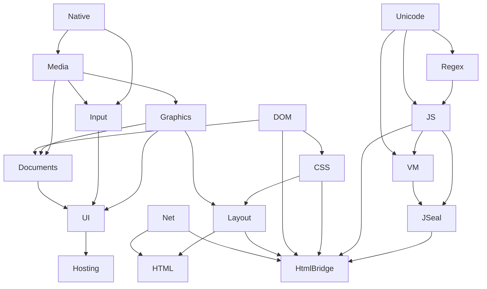
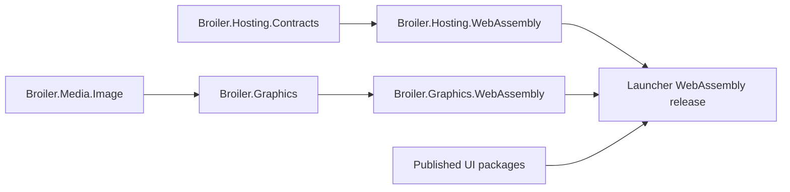

# Broiler NuGet publication dependency order

Calculated from the working tree on 2026-10-29. MSBuild evaluated 310 production source projects in Release configuration, including imports, package IDs, packability, active conditional package/project references and multi-target frameworks. Packaged UI dependencies were selected with `UseBroilerUiSource=false`. Tests, samples, documentation fixtures, nested submodule copies and generated outputs were excluded. No restore, build, pack or publication was performed by this calculation.

Result: **195 packable Broiler package identities, 13 package-level waves, 6 repository-level waves, no dependency cycles, no missing package owners and no evaluation errors.** Every graph edge was checked against its calculated order. This describes source prerequisites, including build-only dependencies; publisher allowlists and validation gates still determine which candidates a release actually ships.

## Recommended order for complete repository releases

Finish a wave before starting the next. Repositories in one row can publish independently in parallel. An already-published dependency that satisfies the consumer pin does not need republishing.

| Wave | Repositories / package families |
| --- | --- |
| 1 | Broiler.Code (`Broiler.SDK` only), Broiler.DOM, Broiler.DateTime, Broiler.Native, Broiler.Net, Broiler.Unicode |
| 2 | Broiler.CSS, Broiler.Media, Broiler.RegEx |
| 3 | Broiler.Graphics, Broiler.Input, Broiler.JS |
| 4 | Broiler.Documents, Broiler.Layout, Broiler.VM |
| 5 | Broiler.HTML, Broiler.JSeal, Broiler.UI, Broiler.Writer (`Broiler.Writer.FormatCodes` only) |
| 6 | Broiler.Hosting, Broiler.HtmlBridge |

`Broiler.Code` here means its NuGet SDK package, not the Code application. `Broiler.Writer` means its FormatCodes NuGet library, not the Writer application release. Launcher, Writer, Cell, Browser, Plate, Code and Mail application releases follow their required libraries; they are not additional NuGet families in this graph.

## Dependency tree between repositories

Arrows run from prerequisite to consumer. The table includes every calculated cross-repository edge.

| Repository | Publish these prerequisites first |
| --- | --- |
| Broiler.CSS | Broiler.DOM |
| Broiler.Code | None within Broiler |
| Broiler.DOM | None within Broiler |
| Broiler.DateTime | None within Broiler |
| Broiler.Documents | Broiler.DOM, Broiler.Graphics, Broiler.Media |
| Broiler.Graphics | Broiler.Media, Broiler.Native |
| Broiler.HTML | Broiler.CSS, Broiler.DOM, Broiler.Graphics, Broiler.Layout, Broiler.Media, Broiler.Net |
| Broiler.Hosting | Broiler.Graphics, Broiler.Input, Broiler.Native, Broiler.UI |
| Broiler.HtmlBridge | Broiler.CSS, Broiler.DOM, Broiler.JS, Broiler.JSeal, Broiler.Layout, Broiler.Net |
| Broiler.Input | Broiler.Media, Broiler.Native |
| Broiler.JS | Broiler.RegEx, Broiler.Unicode |
| Broiler.JSeal | Broiler.JS, Broiler.VM |
| Broiler.Layout | Broiler.CSS, Broiler.DOM, Broiler.Graphics |
| Broiler.Media | Broiler.Native |
| Broiler.Native | None within Broiler |
| Broiler.Net | None within Broiler |
| Broiler.RegEx | Broiler.Unicode |
| Broiler.UI | Broiler.Documents, Broiler.Graphics, Broiler.Input |
| Broiler.Unicode | None within Broiler |
| Broiler.VM | Broiler.JS, Broiler.Unicode |
| Broiler.Writer | Broiler.Documents, Broiler.Media |



The diagram emphasizes the main chains; the table above is the exhaustive repository graph. DateTime and the Code SDK are independent roots.

## Shortest path to unblock Office WebAssembly

Desktop Hosting pulls in UI, so its complete repository release sits in wave 6. Its two new browser packages have a much shorter package-level chain:



1. Use the already-published Media/Image, Input and UI dependencies if their source/API versions remain suitable. No blanket republish is needed.
2. Publish the W1 **Graphics cohort**, including `Broiler.Graphics` and `Broiler.Graphics.WebAssembly` at the same actual release version. Package order is core, then WebAssembly.
3. Publish **`Broiler.Hosting.Contracts`**, then **`Broiler.Hosting.WebAssembly`**. This branch is independent of Graphics at the package level and can run in parallel with step 2. If using the normal full Hosting workflow, all its desktop packages also need the repository-level prerequisites from the table.
4. Wait until these exact versions restore from NuGet.org. Update the Launcher Hosting/Graphics pins to those versions, regenerate and commit its package lock, and run its release verification.
5. Publish the Launcher application/web release. Publish Writer/Cell application web releases to carry their latest browser changes. The website workflow consumes their release ZIPs, not NuGet packages.

The W1 Hosting packages were still unpublished at the preceding version audit. Graphics preview.14 does not supply the W1 generation: selecting the latest currently published number alone does not satisfy that browser-host gate. This report does not invent future release numbers.

## Release procedure at each boundary

* Publish a dependency release and wait for NuGet.org indexing.
* Update downstream central version pins to the release just published, then regenerate affected restore locks and run validation. Publishing a dependency alone does not update consumers.
* Publish the consumer release once restore/build/tests pass.
* Within a repository, project references often allow building the entire cohort before any package is pushed. NuGet can accept uploads before their dependencies are indexed; the order here ensures builds and consumer restores can succeed, rather than imposing an upload API restriction.
* `PrivateAssets=all` dependencies remain in the build-order calculation when they are Broiler packages. They may be absent from the final public nuspec but must still be available to build the producer.

## Exact package-level publication waves

Each wave contains packages whose Broiler prerequisites occur in earlier waves. Packages inside a wave can be pushed together. These waves split repositories deliberately; use the six-wave table when each repository publishes all its packages as one release.

### Package wave 1 (20)

- `Broiler.CSS`
- `Broiler.DateTime`
- `Broiler.Dom`
- `Broiler.ECMAScript.Algorithms`
- `Broiler.ECMAScript.Generation`
- `Broiler.Hosting.Contracts`
- `Broiler.Input`
- `Broiler.JSeal`
- `Broiler.JavaScript.Portable`
- `Broiler.Media`
- `Broiler.Native`
- `Broiler.Net`
- `Broiler.SDK`
- `Broiler.Unicode.Algorithms`
- `Broiler.Unicode.Cldr.LocaleData`
- `Broiler.Unicode.Emoji.StringProperties`
- `Broiler.Unicode.Properties`
- `Broiler.VM.Abstractions`
- `Broiler.VM.Binary`
- `Broiler.VM.HyperV`

### Package wave 2 (25)

- `Broiler.CSS.Dom`
- `Broiler.Dom.Html`
- `Broiler.Hosting.WebAssembly`
- `Broiler.Input.Camera`
- `Broiler.Input.Keyboard`
- `Broiler.Input.Microphone`
- `Broiler.Input.Mouse`
- `Broiler.Input.Pen`
- `Broiler.Input.Text`
- `Broiler.Input.Touch`
- `Broiler.JavaScript.Expressions`
- `Broiler.Media.Audio`
- `Broiler.Media.Image`
- `Broiler.Media.Video`
- `Broiler.Native.Android`
- `Broiler.Native.Linux`
- `Broiler.Native.Windows`
- `Broiler.Regex`
- `Broiler.Unicode.Generation`
- `Broiler.Unicode.Segmentation`
- `Broiler.Unicode.Tables`
- `Broiler.VM.Profile.JavaScript.Format`
- `Broiler.VM.Profile.MachineCode`
- `Broiler.VM.Runtime`
- `Broiler.VM.Ubc`

### Package wave 3 (16)

- `Broiler.Graphics`
- `Broiler.Input.Android`
- `Broiler.Input.Legacy`
- `Broiler.Input.Linux`
- `Broiler.Input.Windows`
- `Broiler.JavaScript.Ast`
- `Broiler.JavaScript.ExpressionCompiler`
- `Broiler.Media.Audio.Managed`
- `Broiler.Media.Image.Managed`
- `Broiler.Media.Video.Windows`
- `Broiler.Native.All`
- `Broiler.VM.Emitter.Bytecode`
- `Broiler.VM.Profile.JavaScript`
- `Broiler.VM.Profile.JavaScript.Compiler`
- `Broiler.VM.Profile.JavaScript.Intl`
- `Broiler.VM.Profile.WebAssembly`

### Package wave 4 (21)

- `Broiler.Documents.Model`
- `Broiler.Graphics.Android`
- `Broiler.Graphics.Linux`
- `Broiler.Graphics.WebAssembly`
- `Broiler.Graphics.Windows`
- `Broiler.Input.All`
- `Broiler.Input.Keyboard.Android`
- `Broiler.Input.Keyboard.Linux`
- `Broiler.Input.Keyboard.Windows`
- `Broiler.Input.Microphone.Windows`
- `Broiler.Input.Mouse.Linux`
- `Broiler.Input.Mouse.Windows`
- `Broiler.Input.Pen.Android`
- `Broiler.Input.Text.Android`
- `Broiler.Input.Touch.Android`
- `Broiler.JSeal.Vm`
- `Broiler.JavaScript.Parser`
- `Broiler.JavaScript.Storage`
- `Broiler.Layout`
- `Broiler.Media.Video.MediaFoundation`
- `Broiler.UI`

### Package wave 5 (34)

- `Broiler.Documents`
- `Broiler.Documents.FormatCodes`
- `Broiler.Documents.Pagination`
- `Broiler.Graphics.Linux.OpenGL`
- `Broiler.Graphics.Linux.Vulkan`
- `Broiler.HTML.Core`
- `Broiler.Hosting.Android`
- `Broiler.Input.Camera.Windows`
- `Broiler.JavaScript.Portable.Compiler`
- `Broiler.JavaScript.Runtime`
- `Broiler.Media.All`
- `Broiler.UI.CheckBox`
- `Broiler.UI.CodeEditor`
- `Broiler.UI.ComboBox`
- `Broiler.UI.Edit`
- `Broiler.UI.Forms`
- `Broiler.UI.ImageView`
- `Broiler.UI.Label`
- `Broiler.UI.ListView`
- `Broiler.UI.Menu`
- `Broiler.UI.Panel`
- `Broiler.UI.PrintPreview`
- `Broiler.UI.ProgressBar`
- `Broiler.UI.RadioButton`
- `Broiler.UI.RichEdit`
- `Broiler.UI.ScrollView`
- `Broiler.UI.Slider`
- `Broiler.UI.SpinBox`
- `Broiler.UI.Splitter`
- `Broiler.UI.Standard`
- `Broiler.UI.TabView`
- `Broiler.UI.Toolbar`
- `Broiler.UI.TreeView`
- `Broiler.UI.Window`

### Package wave 6 (37)

- `Broiler.Documents.Csv`
- `Broiler.Documents.Docx`
- `Broiler.Documents.Html`
- `Broiler.Documents.Markdown`
- `Broiler.Documents.Ods`
- `Broiler.Documents.Odt`
- `Broiler.Documents.Pdf`
- `Broiler.Documents.Rtf`
- `Broiler.Documents.Xlsx`
- `Broiler.HTML.Dom`
- `Broiler.Hosting.Linux`
- `Broiler.JavaScript.Engine`
- `Broiler.UI.Button`
- `Broiler.UI.CheckBox.Standard`
- `Broiler.UI.CodeEditor.Standard`
- `Broiler.UI.ComboBox.Standard`
- `Broiler.UI.Dialog`
- `Broiler.UI.Edit.Standard`
- `Broiler.UI.FormatCodeView`
- `Broiler.UI.ImageView.Standard`
- `Broiler.UI.Label.Standard`
- `Broiler.UI.ListView.Standard`
- `Broiler.UI.Menu.Standard`
- `Broiler.UI.Panel.Standard`
- `Broiler.UI.PrintPreview.Standard`
- `Broiler.UI.ProgressBar.Standard`
- `Broiler.UI.RadioButton.Standard`
- `Broiler.UI.RichEdit.Standard`
- `Broiler.UI.ScrollView.Standard`
- `Broiler.UI.Slider.Standard`
- `Broiler.UI.Splitter.Standard`
- `Broiler.UI.TabView.Standard`
- `Broiler.UI.Toolbar.Standard`
- `Broiler.UI.Tooltip`
- `Broiler.UI.TreeView.Standard`
- `Broiler.UI.Window.Standard`
- `Broiler.Writer.FormatCodes`

### Package wave 7 (17)

- `Broiler.Documents.Pdf.Fonts`
- `Broiler.Documents.Pdf.Images`
- `Broiler.HTML.Orchestration`
- `Broiler.Hosting.Windows`
- `Broiler.HtmlBridge.Core`
- `Broiler.JavaScript.LinqExpressions`
- `Broiler.UI.AboutDialog`
- `Broiler.UI.Button.Standard`
- `Broiler.UI.Dialog.Standard`
- `Broiler.UI.FileDialog`
- `Broiler.UI.FontDialog`
- `Broiler.UI.FormatCodeView.Standard`
- `Broiler.UI.PrintDialog`
- `Broiler.UI.RichEdit.Rtf`
- `Broiler.UI.SpinBox.Standard`
- `Broiler.UI.ToggleButton`
- `Broiler.UI.Tooltip.Standard`

### Package wave 8 (9)

- `Broiler.HTML.Image`
- `Broiler.HtmlBridge.DomBridgeUtils`
- `Broiler.JavaScript.Compiler`
- `Broiler.JavaScript.Extensions`
- `Broiler.UI.AboutDialog.Standard`
- `Broiler.UI.FileDialog.Standard`
- `Broiler.UI.Forms.Standard`
- `Broiler.UI.PrintDialog.Standard`
- `Broiler.UI.ToggleButton.Standard`

### Package wave 9 (3)

- `Broiler.HTML.Image.Compat`
- `Broiler.JavaScript.BuiltIns`
- `Broiler.UI.FontDialog.Standard`

### Package wave 10 (6)

- `Broiler.HTML.Graphics`
- `Broiler.JavaScript.Clr`
- `Broiler.JavaScript.Debugger`
- `Broiler.JavaScript.Globals`
- `Broiler.JavaScript.Modules`
- `Broiler.UI.All`

### Package wave 11 (4)

- `Broiler.HtmlBridge.Dom`
- `Broiler.JSeal.BroilerJs`
- `Broiler.JavaScript.Minimal`
- `Broiler.JavaScript.ModuleExtensions`

### Package wave 12 (2)

- `Broiler.HtmlBridge.Scripting`
- `Broiler.JavaScript.All`

### Package wave 13 (1)

- `Broiler.HtmlBridge.Scripting.Vm`

## Recalculate

```powershell
python scripts/nuget_publish_order.py
```

The script reads MSBuild metadata without restoring/building and writes the evaluated project snapshot plus `publish-order.json` under `artifacts/nuget-publish-order/`. Its `--reuse-evaluation` option recomputes graphs from that snapshot and must not be used after source dependency changes. The checked-in [machine-readable graph](nuget-package-publish-order.json) includes package-to-project ownership, every direct prerequisite, all waves and cycle/error results.
